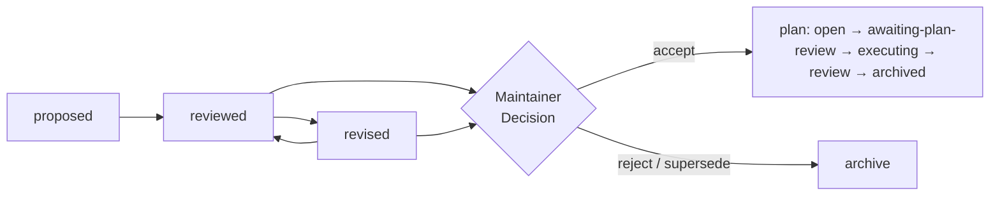

<!-- cairn-internal-ref-allow: doctrine/rationale.md doctrine/lifecycle.md doctrine/dual-review.md reason=doctrine/ citation convention — a doctrine reference is a citation to Cairn's published methodology, not an installed local file (see templates/core/AGENTS.md, "Where doctrine/ references resolve") -->

# Cairn

> A cairn is a trail marker left for those who come after.

**Peer review, for code written with AI agents.** Every substantial change is
read by someone who did not write it — a different AI model, or a person —
first while it is still an argument on a page, and again once it is built. That
review is the point. The written trail it leaves behind is a by-product, and a
useful one.

**The practice comes with it.** Cairn also writes down the software-engineering
discipline most scientists never had the chance to learn, so your agents arrive
already working that way.

---

## Does this sound familiar?

You have been using an AI coding agent on your research software.  The agent
writes good code — fast.  But then:

- You suspect the agent made a scientific assumption you would not have made.
  **Nobody independent ever checked it.**
- The agent reviewed its own work.  **Author and reviewer were the same
  entity**, and neither noticed the gap.
- The reasoning behind last week's change **evaporated when the chat closed**.
  You cannot explain why the model is parameterised this way.
- A colleague asks how you got a result.  **You cannot reconstruct the path** —
  only the output survives.

Cairn is built for this exact moment.

---

## What Cairn is

You already trust a process that works this way. A manuscript is read by
referees who did not write it, before it counts as knowledge. Cairn applies the
same idea to code changes:

| Journal peer review | Cairn |
|---|---|
| Manuscript → editor → referees → decision | Written proposal → maintainer → reviewers → decision |
| A colleague's read before you submit | A first review that helps the change land |
| Independent referees who don't know you | A second review from a **different** AI model, or a person |
| Referee report → your response → revision | Review → response → revised proposal |
| Conflict-of-interest rules | Independence you can check: a different model, or a different human |

Two things differ, and both favour the code case. Independence is easier to
establish — "a different model architecture" is a brighter line than "no recent
co-authorship." And review happens **before the work is done**, when saying
"that is the wrong thing to build" is still cheap.

One thing is harder, and worth knowing up front: your reviewers are as diverse
as the AI models you have access to. A second model reduces the chance of a
shared blind spot; it does not eliminate it.

### The practice you did not have a chance to learn

Most scientists writing research code did not train as software engineers, and
there is rarely a senior engineer down the hall to learn it from. The craft
exists — when something deserves a test, what a change should be checked
against, how to keep a repository honest, what to do about secrets and
dependencies, when to stop and ask a person. You would normally absorb it over
years, from whichever colleagues you happened to have.

Cairn writes it down and hands it to your agents. They arrive already working
that way: arguing a change before building it, testing what they claim, keeping
commits clean, and stopping at the points where a person should decide. You do
not have to know all of it in advance — the review is what checks they actually
did it.

And it is yours to change. Cairn is **opinionated** about engineering practice,
but the opinions arrive as plain text in your repository, not as a black box:

- **Edit the rules.** The doctrine your agents follow is a file you own. If a
  rule does not fit your project, change it.
- **Fill in your own.** The templates ship with deliberate blanks for your
  project's conventions, and one folder is yours entirely — Cairn never writes
  to it.
- **Your changes survive updates.** Pulling a newer Cairn merges rather than
  overwrites, so local edits are not silently reverted.
- **Send the good ones back.** If a change you made turns out to be generally
  useful, there is a channel for returning it upstream.

Bringing in a disciplined team means adopting somebody's idea of discipline.
This way you can see exactly whose, read what it says, and disagree in
writing.

---

## What you get

- **Someone independent checks the thinking before any code is written.** A
  change starts as a short written argument. A reviewer who did not write it
  reads that argument while it is still cheap to say "that assumption is
  wrong" — before it is buried in a result.
- **The reviewer is genuinely independent, and you can see that they were.**
  The stronger review has to come from a different AI model, or from a person.
  Who reviewed what is written down in your repository, not claimed.
- **You write down what would prove you wrong, before you look.** The same
  discipline as pre-registering an analysis: the test is fixed before the
  result is known, so it cannot be quietly adjusted afterwards.
- **Nothing locks you in.** The whole system is plain text files kept under
  version control. You can change AI tools, or programming languages, without
  changing how you work.
- **Sized to your project, and yours to change.** A solo script and a
  fifteen-year model do not get the same treatment. You start light, add only
  what your work earns, and rewrite any rule that does not fit — the doctrine
  is a file in your repository, not a setting in someone's product.
- **Nothing to install but Python, and nothing leaves your machine.** No
  accounts, no service, no data sent anywhere.

New vocabulary is a real cost of adopting any method.
[`docs/glossary.md`](docs/glossary.md) defines the terms that carry weight.

### The record is a by-product

Cairn keeps every proposal, every review, and every response in your
repository, next to the code. That trail is genuinely useful a year later — you
can see why a parameter is 0.3, who challenged it, and what they were told.

But it is not why you would adopt this. You write the argument down because a
reviewer needs something to argue with, and you keep the review because that is
how you know it happened. Do review properly and the record falls out of it. Aim
at the record instead, and you get paperwork.

### Isn't this just careful prompting with extra steps?

**It does produce better code, and the reason is not mysterious.** A second
reader who did not write the work catches what the writer cannot see — the same
reason you do not referee your own manuscript, and do not calibrate an
instrument against itself. Cairn puts that reader in the loop twice: once while
the change is still an argument, and again after it is written. The agent is
unchanged; what changes is that its work is checked at the point where fixing it
is cheapest.

It is still slower for the first few changes. The payback is fewer things to
undo later — and an unrecorded session cannot tell you why a change was made,
who checked it, or what would have shown it to be wrong. If you never need to
answer those questions, you do not need Cairn.

Decision records, formal proposal processes, lab notebooks, pre-registration and
ordinary code review all overlap with what Cairn does.
[`docs/related-practices.md`](docs/related-practices.md) compares them honestly
and names the four things that are genuinely different.

---

## How a change moves

A change is argued in a **proposal**, reviewed, revised if the review found
something, and then decided by you. Larger work gets a **plan** that carries it
through implementation and a second review of the code itself. Every step is a
commit, so the sequence is visible afterwards.

*A faithful simplification of `doctrine/lifecycle.md` — no invented or
contradicting transition, and no named state dropped.*

**This works with one agent.** If you have a single AI tool, your own read or a
fresh session covers the first review. The stronger independent review arrives
when a second model — or a second person — is available. You do not need a team
to start.

---

## What is proven, and what is not

Cairn's practices are not invented from first principles. They answer to
published research on human–AI software development, on trust in automated
systems, and on rigour in scientific software, and
[`doctrine/rationale.md`](doctrine/rationale.md) records where Cairn follows
that work and where it deliberately departs from it.

**Cairn does not claim to be validated science.** It claims to be grounded in
peer-reviewed work and explicit about where it diverges. No controlled study
shows that adopting Cairn improves outcomes; what exists is two projects using
it, and reasoning you can check.

The same honesty applies to who has tested it. Every deployment so far is one
its own maintainer is close to. An independent adoption — by people who did not
help write the doctrine — is the test that has not happened yet.

One rule runs underneath everything: **you cannot decide what you cannot
follow.** Cairn requires its agents to explain in plain language and to stop
when you do not understand, because a decision you cannot follow is not a
decision you are really making.

See [`docs/further-reading.md`](docs/further-reading.md) for the wider
craft literature — the Turing Way, the PLOS "Ten simple rules" papers, and the
verification-and-validation canon.

---

## Trust and safety

> **What stays on your machine — and what doesn't.** Cairn's own tools never
> phone home: they read and write only inside your repository and never act
> around your approval.  But the AI agents you run **do** send everything they
> read to their model provider — that is how they work — so the tree,
> proposals, and plans **must never contain** secrets, credentials, private
> paths, embargoed datasets, or unpublished results.
>
> Cairn agents also **run commands and execute local code**, so point them only
> at inputs you trust and keep credentials out of the environment.  See
> [`SECURITY.md`](SECURITY.md) for the full contract: what the agent reads,
> what the scanners check, and the residual risks.

---

## Who this is for

- A scientist, or a small research-software team, writing code for your own
  research — models, data pipelines, calibration, analysis.
- Using one or more AI coding agents. Any vendor; Cairn does not care which.
- Wanting your AI-assisted work reviewed and recorded rather than just
  prompted — and willing to keep that record in git alongside the code.

Cairn is **not** a project-management framework, a testing tool, or a prompt
library. It sits upstream of those: it governs how one change is argued,
checked, and recorded.

---

## How to adopt

**Try it first.**  Follow [`docs/quickstart.md`](docs/quickstart.md) on a
disposable repository: one human, one AI agent, one trivial change through the
full lifecycle.  It is a short walkthrough, and nothing it installs touches a
repository you care about.  If you would rather see it on something that looks
like science than on a toy,
[`examples/scientific-minimal/`](examples/scientific-minimal/) runs the same
lifecycle over a mass-balance invariant test.

**Then pick a depth.**  The on-ramp below is the real next step.

Prefer to read before running?
[`docs/getting-started.md`](docs/getting-started.md) narrates one change moving
through the lifecycle, and [`docs/workflow-role.md`](docs/workflow-role.md)
explains where Cairn sits — and what it deliberately does *not* do.

Three graduated levels (see [`on-ramp/README.md`](on-ramp/README.md)
for the full ladder):

- **Level 0 — read the doctrine.**  Read [`doctrine/`](doctrine/)
  as a handbook; let it inform how the team already works.  No
  apparatus, no `dev/` tree.  The lowest-commitment entry.
- **Level 1 — hand-copy the kernel.**  Copy
  [`templates/core/`](templates/core/) into the repository, add
  the modules your dimensional profile selects, run the lifecycle
  by hand.
- **Level 2 — full bootstrap.**  Run
  [`bootstrap/scaffold.py`](bootstrap/scaffold.py) against a
  profile YAML; the bootstrap procedure
  ([`bootstrap/BOOTSTRAP.md`](bootstrap/BOOTSTRAP.md)) walks an
  agent and the maintainer through assessment, install,
  customization, and a dogfood pass.

The bootstrap is intentionally single-agent: one capable reasoning agent
running alongside you, working from
[`bootstrap/BOOTSTRAP.md`](bootstrap/BOOTSTRAP.md).

**Bringing an older scientific codebase?**  Fill
[`templates/codebase-readiness-report.md`](templates/codebase-readiness-report.md)
first.  Its eleven sections — tests, hidden state, data handling,
reproducibility, security, scientific assumptions and more — surface the
questions that matter *before* you pick a depth, and its scoring appendix turns
your answers into a recommended starting point.

---

## Repository layout

| Path | What it holds |
|------|---------------|
| [`doctrine/`](doctrine/) | The invariant core: lifecycle, dual-review, coordination, role roster, session routines, rationale. |
| [`dimensions/`](dimensions/) | The six adaptation axes (age, size, complexity, language, human team, agent team) and the three module layers. |
| [`templates/`](templates/) | The forkable files: `core/` (the kernel), `modules/default-on/` and `modules/team-gated/` (the dimension-selected add-ons), `phase-0/` (the assessment templates), and `onboarding/` (the progressive-onboarding presets). |
| [`bootstrap/`](bootstrap/) | The three-act install procedure (`BOOTSTRAP.md`), the scaffold that performs it (`scaffold.py` + tests), the safety rules it operates under (`SAFETY.md`), and the fidelity-check manifest spec (`fidelity-check.md`). |
| [`case-studies/`](case-studies/) | Worked examples of the matrix applied: [`modflow_tools.md`](case-studies/modflow_tools.md) (smaller sibling) and [`lhm.md`](case-studies/lhm.md) (full apparatus). |
| [`on-ramp/`](on-ramp/) | The graduated-adoption ladder (Level 0 / 1 / 2). |
| [`docs/`](docs/) | Adopter orientation: Cairn's role in the workflow (`workflow-role.md`), a getting-started walkthrough (`getting-started.md`), and a curated further-reading signpost (`further-reading.md`). |
| [`examples/`](examples/) | Worked examples; [`examples/minimal/`](examples/minimal/) traces one change through the lifecycle at the smallest scale, and [`examples/scientific-minimal/`](examples/scientific-minimal/) does the same on a tiny science workflow (a mass-balance invariant test). |

---

## Status

Cairn is released at **v0.3.0** (2026-06-12).

- **Phases 1–4 complete**: doctrine extraction, forkable templates,
  bootstrap procedure + scaffold + a full bootstrap and gate test
  suite, and two case studies (modflow_tools, LHM) covering
  opposite-leaning points on the dimension matrix.
- **Phase 5 — launch and governance — in progress.**
- **An independent correctness probe is still outstanding**: it awaits a
  consenting third-party scientific repository that did not contribute to the
  doctrine.  Until one exists, every deployment Cairn has been tested against
  is one its own maintainer is close to.  The
  bootstrap is validated end-to-end against modflow_tools through
  the v1 reference manifest at
  [`case-studies/modflow_tools-fidelity-manifest.yml`](case-studies/modflow_tools-fidelity-manifest.yml).

The methodology is in active use in two real projects.  Cairn is
the generalized doctrine extracted from that practice.

---

## License

Licensed by file kind, with **source code taking precedence** — a code
file is MIT wherever it lives, even inside the otherwise-CC-BY templates:

- **Source code — MIT.** Every `.py` and other source-code file,
  *wherever it lives* — `bootstrap/scaffold.py` and its tests, and the
  shipped tools under `templates/` (e.g.
  `templates/modules/team-gated/link_check.py`) and `scripts/` — is
  licensed under the **MIT License**.  See
  [`LICENSE-MIT.md`](LICENSE-MIT.md).
- **Prose, document templates, and explanatory visuals — CC BY 4.0.**
  The doctrine, dimensions, case studies, bootstrap narrative, README,
  the *document* templates (the Markdown under `templates/`), and the
  explanatory diagrams in `docs/assets/` are licensed under **Creative
  Commons Attribution 4.0 International (CC BY 4.0)**.  See
  [`LICENSE-CC-BY.md`](LICENSE-CC-BY.md).
- **Project-identity graphics — CC BY-ND 4.0.** The Cairn banner /
  brand mark (`docs/assets/cairn-banner.svg`) alone is licensed under
  **Creative Commons Attribution-NoDerivatives 4.0 International
  (CC BY-ND 4.0)**: share with attribution, but no modified versions,
  so the identity mark stays canonical.  See
  [`LICENSE-CC-BY-ND.md`](LICENSE-CC-BY-ND.md).

The three families never overlap: source code is MIT (even when shipped
under `templates/`); human-readable documents and explanatory visuals
are CC BY; the brand mark alone is CC BY-ND.  The licenses are
intentionally compatible.

---

## Citation

If you use Cairn, please cite it.  See [`CITATION.cff`](CITATION.cff)
for citation metadata.  Until a GitHub release is published and a
Zenodo DOI is issued, cite by version (**v0.3.0**) and the
repository URL; the DOI lands in `CITATION.cff` and a release-tag
note here once minted.

---

## Origin

Cairn generalizes the apparatus developed for the
[`modflow_tools`](https://gitlab.msu.edu/hydrogeology/code-projects/modflow_tools)
groundwater-modeling project — the reference instance — and is
extended through application to a second project (LHM, MSU
Hydrology).  Both case studies are in
[`case-studies/`](case-studies/).

The Cairn repository itself is built using Cairn — its
construction is recorded as a `cairn_methodology_repo` plan in the
modflow_tools repository's own `dev/plans/` lifecycle, with each
phase ending in a required Internal review before the next phase
starts.  The plan is the artifact; Cairn is the deliverable.
