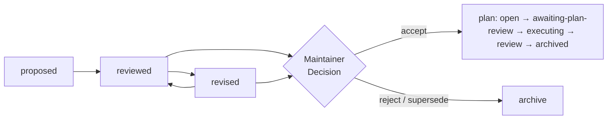

<!-- cairn-internal-ref-allow: doctrine/rationale.md doctrine/lifecycle.md doctrine/dual-review.md reason=doctrine/ citation convention — a doctrine reference is a citation to Cairn's published methodology, not an installed local file (see templates/core/AGENTS.md, "Where doctrine/ references resolve") -->

# Cairn

> A cairn is a trail marker left for those who come after.

---

## Does this sound familiar?

You have been using an AI coding agent on your research software.  The
agent writes good code — fast.  But then:

- The reasoning behind last week's change **evaporated when the chat
  closed**.  You cannot explain why the model is parameterized this way.
- A reviewer asks how you got a result.  **You cannot reconstruct the
  path** — only the output survives.
- You suspect the agent made a scientific assumption you would not have
  made.  **Nobody independent ever checked it.**
- The agent reviewed its own work.  **Author and reviewer were the same
  entity**, and neither noticed the gap.

Cairn is built for this exact moment.

---

## What doing it better looks like

| Working with AI, ad hoc | The same work, with Cairn |
|---|---|
| Reasoning lives in chat; gone on close | Reasoning committed as a reviewed proposal |
| Agent is sole author **and** sole reviewer | Review across structural independence (fresh session / different model) |
| A wrong scientific assumption ships | Caught at proposal review, before any code |
| "How did I get this result?" | The deliberation record **is** the answer |
| Slower? Faster? Hard to know | Slower for the first few changes; the overhead pays back in fewer rework cycles |

---

## Cairn is a methodology, not software

Cairn is an Open Science repository for scientists building
scientific-computing software who are adopting AI agents and care about
rigor, reproducibility, and review discipline.

Cairn has four jobs:

1. **Explain the doctrine** — the invariant core of a human + AI
   development methodology, and *why* each piece exists.
2. **Ship forkable templates** — `AGENTS.md`, the `dev/`
   coordination tree, the proposal / plan / review templates, the
   session routines.
3. **Ship a single-agent bootstrap** — a procedure plus a thin
   script that installs and customizes the apparatus into a target
   repository, adapting it along a set of codebase and team
   dimensions.
4. **Show two worked case studies** — two real scientific-software
   projects as contrasting points in that dimensional space.

The two differentiators Cairn leads with: an **append-only,
git-committed deliberation lifecycle**, and a **Dual-Review model**
(two-tier review across structural independence).

> **The adoption promise.**  Start small.  Use Cairn to make one
> AI-assisted change with a recorded decision and test.  Keep the
> apparatus only as heavy as your codebase and team earn.

---

## The lifecycle at a glance

Every substantive change moves through a proposal (deliberation) and,
for non-trivial work, a plan (execution).  Both are append-only,
git-committed, and reviewed before the code lands.

*A faithful simplification of `doctrine/lifecycle.md` — no invented or
contradicting transition; named states are not dropped.*

---

## Why it works: the Dual-Review model

**Internal review** (same agent type, fresh session) helps a change
land — a constructive second read.  **External review** (different
agent type, or a human) makes a change prove it should land — an
independent read that sharply lowers the chance of a *shared*
training-time blind spot (it reduces correlated failure; it cannot
eliminate it).  Both are
asynchronous, commit-mediated, and attributed.

**Cairn works with one agent.**  At that scale, the Maintainer's own
review or a fresh-session review from the same agent type covers the
Internal tier.  The stronger External floor lands once a second agent
type or a second human reviewer is available.  See
[`on-ramp/README.md`](on-ramp/README.md) for the graduated path.

---

## Grounded in research — and honest about the limits

Cairn's practices are not invented from first principles.  They answer
to a body of research on human-AI software development, multi-agent
role design, trust calibration, and scientific-software rigor —
and `doctrine/rationale.md` records where Cairn **follows** that
literature and where it deliberately **diverges** from it.

Two examples of where Cairn takes a named position:

- **On review:** Cairn's Dual-Review is closer to scientific peer
  review (anchor 6 in `doctrine/rationale.md`) than to the
  multi-agent debate pattern dominant in the 2025 literature — a
  deliberate choice, with stated reasoning.
- **On coordination:** Cairn coordinates through persistent `dev/`
  artifacts (the stigmergy lineage, anchor 5) rather than real-time
  agent protocols — also deliberate, and explained.

Cairn **does not claim to be peer-reviewed science**.  It claims to be
*grounded in peer-reviewed work on human-AI software development* and
*explicit about where it diverges*.  That distinction is the honest
center.  The comprehension floor (anchor 16) runs underneath the whole
system: you cannot legitimately decide what you cannot understand, so
every Cairn output is written to be followable by the human Maintainer,
not just by the next AI session.

See [`doctrine/rationale.md`](doctrine/rationale.md) for the full
follows-and-diverges treatment, and
[`docs/further-reading.md`](docs/further-reading.md) for the curated
craft signpost (the Turing Way; the PLOS "Ten simple rules" set;
the V&V canon).

---

## Honest framing

Cairn is **slower for the first few changes**.  Its speed comes
later: fewer repeated decisions, fewer forgotten assumptions, fewer
agent collisions, and less rework after unreviewed scientific
choices.  Keep the apparatus only as heavy as your codebase and team
earn — the [on-ramp](on-ramp/README.md) is the self-locate aid for
that calibration.

---

## Who Cairn is for

- A scientist or research-software team building scientific code
  (numerical simulation, data pipelines, calibration / inversion,
  ML for science).
- Adopting one or more AI coding agents (any vendor; Cairn is
  vendor-neutral throughout).
- Wanting recorded, reviewed deliberation rather than ad-hoc
  prompting — and willing to commit the apparatus to git.
- Working at a graduate-research, faculty-research, or small-group
  scale (one human plus agents, up to a small multi-human team).

Cairn is **not** a project-management framework, a CI/CD tool, or a
prompt library.  It is upstream of those — the doctrine that decides
what gets prompted, reviewed, and shipped.

---

## Trust and safety

> **What stays on your machine — and what doesn't.** Cairn's own
> tools never phone home: they read and write only inside your
> repository and never act around your approval.  But the AI agents
> you run **do** send everything they read to their model provider —
> that's how they work — so the tree, proposals, and plans **must
> never contain** secrets, credentials, private paths, embargoed
> datasets, or unpublished results.
>
> Cairn agents also **run commands and execute local code**, so point
> them only at inputs you trust and keep credentials out of the
> environment.  See [`SECURITY.md`](SECURITY.md) for the full
> contract: what the agent reads, what the scanners check, and the
> residual risks.

---

## How to adopt — try it in 15 minutes

Want to see the apparatus before committing to a level?  Follow
[`docs/quickstart.md`](docs/quickstart.md) on a disposable repo — one
human + one AI agent, one trivial change through the full lifecycle,
in 15–25 minutes.

New to Cairn? [`docs/getting-started.md`](docs/getting-started.md)
narrates one change moving through the lifecycle, and
[`docs/workflow-role.md`](docs/workflow-role.md) explains where Cairn
sits in the workflow — and what it deliberately does *not* do.

Three graduated levels (see [`on-ramp/README.md`](on-ramp/README.md)
for the full ladder):

- **Level 0 — read the doctrine.**  Read [`doctrine/`](doctrine/)
  as a handbook; let it inform how the team already works.  No
  apparatus, no `dev/` tree.  The lowest-commitment entry.
- **Level 1 — hand-copy the kernel.**  Copy
  [`templates/core/`](templates/core/) into the repository, add
  the modules your dimensional profile selects, run the lifecycle
  by hand.
- **Level 2 — full bootstrap.**  Run
  [`bootstrap/scaffold.py`](bootstrap/scaffold.py) against a
  profile YAML; the bootstrap procedure
  ([`bootstrap/BOOTSTRAP.md`](bootstrap/BOOTSTRAP.md)) walks an
  agent and the maintainer through assessment, install,
  customization, and a dogfood pass.

The bootstrap is intentionally single-agent: one capable reasoning
agent running alongside the Maintainer, working from
[`bootstrap/BOOTSTRAP.md`](bootstrap/BOOTSTRAP.md).

**Bringing a legacy scientific codebase to Cairn?**  Fill
[`templates/codebase-readiness-report.md`](templates/codebase-readiness-report.md)
first.  The eleven-section assessment (tests, hidden state, data I/O,
reproducibility, security boundaries, scientific assumptions, and
more) surfaces the load-bearing questions *before* you pick a level,
and the profile-mapping appendix translates your G/M/P scores into a
recommended Cairn level + module roster.

---

## Repository layout

| Path | What it holds |
|------|---------------|
| [`doctrine/`](doctrine/) | The invariant core: lifecycle, dual-review, coordination, role roster, session routines, rationale. |
| [`dimensions/`](dimensions/) | The six adaptation axes (age, size, complexity, language, human team, agent team) and the three module layers. |
| [`templates/`](templates/) | The forkable files: `core/` (the kernel), `modules/default-on/` and `modules/team-gated/` (the dimension-selected add-ons), and `phase-0/` (the assessment templates). |
| [`bootstrap/`](bootstrap/) | The R-A three-act bootstrap procedure (`BOOTSTRAP.md`), the mechanical scaffold (`scaffold.py` + tests), safety rules (`SAFETY.md`, R-I), and the fidelity-check manifest spec (`fidelity-check.md`, R-H). |
| [`case-studies/`](case-studies/) | Worked examples of the matrix applied: [`modflow_tools.md`](case-studies/modflow_tools.md) (smaller sibling) and [`lhm.md`](case-studies/lhm.md) (full apparatus). |
| [`on-ramp/`](on-ramp/) | The graduated-adoption ladder (Level 0 / 1 / 2). |
| [`docs/`](docs/) | Adopter orientation: Cairn's role in the workflow (`workflow-role.md`), a getting-started walkthrough (`getting-started.md`), and a curated further-reading signpost (`further-reading.md`). |
| [`examples/`](examples/) | Worked examples; [`examples/minimal/`](examples/minimal/) traces one change through the lifecycle at the smallest scale. |

---

## Status

Cairn is being released at **v0.1.0**.

- **Phases 1–4 complete**: doctrine extraction, forkable templates,
  bootstrap procedure + scaffold + 38 unit tests, and two case
  studies (modflow_tools, LHM) covering opposite-leaning points on
  the dimension matrix.
- **Phase 5 — launch and governance — in progress.**
- **R-H third-party correctness probe (chunk 5.3 of the plan)** is
  outstanding: it awaits a consenting third-party scientific
  repository that did not contribute to the doctrine.  The
  bootstrap is validated end-to-end against modflow_tools through
  the v1 reference manifest at
  [`case-studies/modflow_tools-fidelity-manifest.yml`](case-studies/modflow_tools-fidelity-manifest.yml).

The methodology is in active use in two real projects.  Cairn is
the generalized doctrine extracted from that practice.

---

## License

Licensed by file kind (three families):

- **Prose, templates, and explanatory visuals** — doctrine,
  dimensions, case studies, bootstrap narrative, README, template
  documents, and the explanatory diagrams in `docs/assets/` — are
  licensed under **Creative Commons Attribution 4.0 International
  (CC BY 4.0)**.  See [`LICENSE-CC-BY.md`](LICENSE-CC-BY.md).
- **Project-identity graphics** — the Cairn banner / brand mark
  (`docs/assets/cairn-banner.svg`) — are licensed under **Creative
  Commons Attribution-NoDerivatives 4.0 International (CC BY-ND 4.0)**:
  share with attribution, but no modified versions, so the identity
  mark stays canonical.  See the deed at
  https://creativecommons.org/licenses/by-nd/4.0/.
- **Scripts** — `bootstrap/scaffold.py` and its tests — are
  licensed under the **MIT License**.  See
  [`LICENSE-MIT.md`](LICENSE-MIT.md).

The boundary is by file kind: text-for-humans and explanatory
visuals fall under CC BY; project-identity graphics under CC BY-ND
(reuse with attribution, no derivatives); code-for-machines under
MIT.  The licenses are intentionally compatible.

---

## Citation

If you use Cairn, please cite it.  See [`CITATION.cff`](CITATION.cff)
for citation metadata.  The first release carries a Zenodo DOI —
once the release is cut, the DOI lands in `CITATION.cff` and a
release-tag note here.

---

## Origin

Cairn generalizes the apparatus developed for the
[`modflow_tools`](https://gitlab.msu.edu/hydrogeology/code-projects/modflow_tools)
groundwater-modeling project — the reference instance — and is
extended through application to a second project (LHM, MSU
Hydrology).  Both case studies are in
[`case-studies/`](case-studies/).

The Cairn repository itself is built using Cairn — its
construction is recorded as a `cairn_methodology_repo` plan in the
modflow_tools repository's own `dev/plans/` lifecycle, with each
phase ending in a required Internal review before the next phase
starts.  The plan is the artifact; Cairn is the deliverable.
