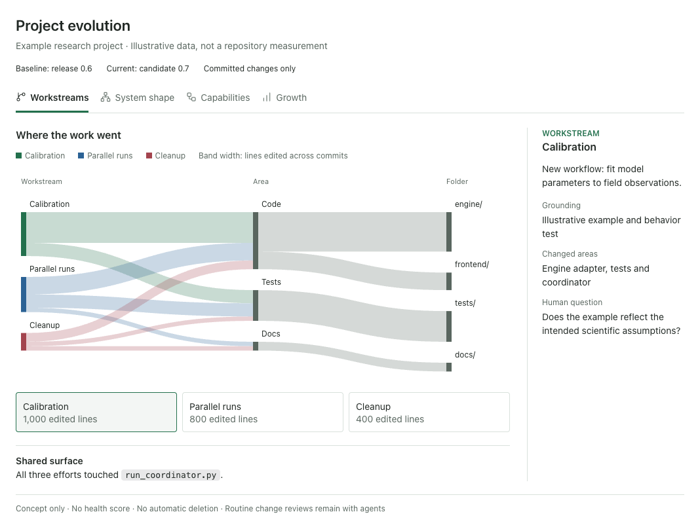

# Code review at agent scale

**Author**: Codex / Strategy
**Model**: Codex (exact runtime model identifier unavailable)
**Date**: 2026-10-28
**Status**: revised
**Type**: design-exploration
**Surfaces this would feed**: v0.7 adopter support for agent change review and visual human review of codebase evolution. This note authorizes no implementation or policy change.

## The question / felt gap

Agent teams can produce changes faster than scientists can read them. Cairn needs two complementary capabilities: **agents review individual changes; people review the evolving system**. Humans need not inspect every patch. They should understand what the software can now do, how its structure is changing, and whether complexity is earning its keep.

Explore a visual, evidence-linked **codebase review**, comparing a chosen release or commit with the current system. It answers: what did we build, how does it fit together, and what should we consolidate? It is not another approval gate or an automatic bloat verdict.

## Method

Surveyed research through 2026-10-28 using [Consensus](https://consensus.app/search/we-are-designing-a-stage-0-strategy-for-a-vendor-n/_nAR66dJQ26RyG3grawJlA/), arXiv and primary engineering accounts. Opened the sources below; this was a targeted survey, not a systematic review. Consensus supplied discovery leads, not independent verification.

Read Cairn's [review doctrine](../../docs/methodology/dual-review.md), [review sweep](../agent_collaboration.md#the-review-sweep), architecture/testing modules, adjacent strategies and [gauge](../../tools/gauge.py).

External-repo paths: inspected LHM's `tools/scope_map.py`, `tools/scope_map.html` and `tests/test_scope_map.py` at LHM commit `8d0460e8` (those paths were clean). This was source/documentation inspection, not an execution audit, benchmark or adopter trial.

## Findings

### Evidence and its limits

| Source | Implication; limit |
|---|---|
| [Bacchelli & Bird, ICSE 2013](https://www.microsoft.com/en-us/research/publication/expectations-outcomes-and-challenges-of-modern-code-review/); [Sadowski et al., ICSE SEIP 2018](https://research.google/pubs/modern-code-review-a-case-study-at-google/) | Understanding, knowledge transfer and small review cycles matter alongside defects. Industrial practice does not establish a scientist's ideal workload. |
| [Alami & Ernst, CHASE 2025](https://arxiv.org/abs/2501.02092); [Zhong et al., March 2026 preprint](https://arxiv.org/html/2603.15911v1) | Excess feedback can burden reviewers. Suggestion adoption is not correctness or causal productivity. |
| [c-CRAB, March 2026 v1](https://arxiv.org/html/2603.23448v1); [CRBugBench, October v1](https://arxiv.org/html/2610.13668v1); [SecPRBench, October 24 v1](https://arxiv.org/abs/2610.33509) | Use independently grounded faults and behavioral evidence. Context, repair agents and model judges limit comparisons. More agents need not improve detection. Benchmarks do not establish scientific validity. |
| [Anthropic engineering account, October 15](https://claude.dev/blog/solving-code-review-at-anthropic/); [StrongDM software factory](https://factory.strongdm.ai/) | Explore fresh-context review, author verification and independent scenarios. These practitioner accounts do not validate a universal workflow. |

The visual system-review design is a hypothesis, not an intervention these studies validated.

### Existing foundation and collection boundary

LHM's Sankey connects **workstream -> area -> folder**, with commits/files behind selections and a shared-files panel. Reuse this interaction rather than build a rival. Its page loads CDN libraries; it is not fully offline.

Cairn's `gauge.py` already classifies paths and collects weekly additions with `git log`. It does not yet provide the proposed endpoint/range interface. Extend its collection boundary into shared standard-library helpers consumed by both commands: one history extractor, one endpoint-diff extractor and shared project-owned classification rules, not two competing collectors. Correct Cairn's classification through [team measurement](archive/2026-10-27-antigravity-lightweight-team-measurement.md); do not impose its product/machinery categories on adopters. Preserve unknown categories. Workstream ownership and file category are separate dimensions.

### Four linked views

| View | Graphic and question | Evidence behind selection |
|---|---|---|
| **Workstreams** | LHM-style flow: which efforts changed which areas? Width measures editing activity or file touches, with explicit units. | Commits, files, attribution reasons, shared surfaces and unmatched work. Overlap is an integration question, not a demonstrated conflict. |
| **System shape** | Stable-layout component/dependency map: where are responsibilities and connections accumulating? | Curated component ownership, entry points and cited relationships. Label declarations, observations and agent inferences separately. |
| **Capabilities** | Workflow matrix: which user/scientific capabilities are new, changed, removed or uncertain? | Explicit workflow declarations linked to components, examples and existing tests/demonstrations. A plan or feature name alone remains an unverified claim. |
| **Growth and consolidation** | Endpoint size bars; optional duplication/change-together overlays. Which growth warrants investigation? | Per-file additions/deletions, method, contributing workstreams and reasons to retain competing implementations. No automatic deletion verdict. |

A scientist could select a coordinator touched by three workstreams, compare added workflows with repeated orchestration, and commission a focused investigation rather than read hundreds of commits.

### Attribution and measurement

Use this order for workstream attribution:

1. Explicit plan/proposal identifiers in commit trailers or durable commit-body links.
2. A single lifecycle artifact touched by the commit.
3. An exact known lifecycle stem in the subject, normalized through project-owned aliases.
4. An explicit **unattributed / maintenance** bucket.

Conflicting identifiers remain ambiguous with all candidates shown; precedence never hides a contradiction. Record the matching rule. Branch names and path categories alone establish no ownership: branches move and one area can serve several efforts.

Keep accumulated editing activity separate from actual endpoint differences. Repeated edits, reversals, renames and merge resolutions make them different. Report each shared file's endpoint delta **once**, alongside contributing workstreams; never divide its net growth among overlapping efforts. Binary/unsupported measurements stay explicit. LHM excludes merge commits from history; endpoint comparison must still include their resulting content. Show generation time separately from commit time and keep working-tree material separate.

## Options

**Do nothing:** retain `board.py`, `gauge.py` and written architecture assessments. Cheapest, but leaves system understanding largely textual.

**Reuse an existing product:** trial [CodeCharta](https://github.com/MaibornWolff/codecharta)'s metric maps, dependencies and version comparison. Assess setup, privacy and maintenance before building equivalents.

**Compose a portable report:** reuse LHM's interaction and shared collection, with curated evidence for semantic views. More tailoring and maintenance, but fits Cairn's lifecycle and scientific context.

Optional tools include [Code Maat](https://github.com/adamtornhill/code-maat) for files changing together, [pydeps](https://github.com/thebjorn/pydeps) for Python import graphs, [jscpd](https://github.com/kucherenko/jscpd) for duplication, [nbdime](https://nbdime.readthedocs.io/en/latest/) for notebooks and [reviewdog](https://github.com/reviewdog/reviewdog) for diagnostics. [PR-Agent](https://github.com/The-PR-Agent/pr-agent), [OpenQodex](https://github.com/openqodex/openqodex), [revmux](https://github.com/umputun/revmux) and [Review Council](https://github.com/deployhq/review-council) supply change-review integration ideas. Documentation was inspected, not implementations audited. Pin and assess licenses, execution and data transmission before adoption.

## Recommendation

Pilot the composed report against unchanged practice and an existing product. Sequence two layers without removing any of the four outcomes:

**First, a deterministic, language-agnostic core:** Workstreams and Endpoint Growth from git and committed lifecycle links, using shared collection/classification with `gauge.py`. Language-agnostic means no source-language parser, not semantic understanding.

**Then, evidence-backed System shape and Capabilities:** reuse the [architecture rubric](../../templates/modules/team-gated/architecture_review_template.md)'s current-shape and workflow-coherence material and project workflow tests/examples under [testing-discipline](../../templates/modules/team-gated/testing-discipline.md). These are prose and tier guidance today, not structured capability manifests. Pilot a thin adapter to explicit, cited declarations; do not invent an existing schema or require a second always-maintained inventory. Missing declarations produce visible gaps. Language-specific analyzers enrich evidence optionally; they are never prerequisites.

Use stable layouts, grouping and non-graphical equivalents. Separate production, tests, generated material, dependencies, documentation and deliberation. No composite health score or deletion quota: growth can preserve compatibility, reproducibility or clarity; static unreachability cannot prove an interface unused.

Default to fully offline HTML with inline SVG/styles/scripts and no CDN, font, telemetry or other network requests. Cairn's shipped core remains standard-library-only; optional analyzers retain their own dependencies. Generate on request or project milestones, with stale/missing evidence visible. Escape repository-controlled display data; no implicit candidate execution, upload or publication.

Routine agent review still needs independent reconstruction, actionable findings, revision closure and preserved dissent. Reuse valid checks rather than multiply broad runs. Human choices initiate normal reviewed work; missing review or failed verification never becomes a green graphic.

## Open questions and falsification

Choose pilot projects, capability evidence, declaration upkeep, language coverage and refresh ownership. Measure annotation effort as well as runtime/token cost. On milestone histories containing justified growth and independently prepared duplication, drift and capability overclaims, compare scientists' accuracy/time explaining the system and identifying worthwhile consolidation against `board.py`, `gauge.py` and the rubric alone. Count false alarms and missed problems; evaluate routine defect detection separately. Reject graphics that improve neither understanding nor decisions, or require unreliable guesses to populate.

Compose with [engineering practices](archive/2026-10-27-codex-adopter-engineering-practices.md), [scientific testing](archive/2026-10-27-antigravity-judicious-testing-and-simulation-verification.md) and [scoped verification](../plans/archive/2026-10-28-scoped-change-verification.md); their scopes remain intact.

## Fold-up note

The eventual review guidance and portable interface should serve shipped adopter projects, not just Cairn. Promotion still needs a proposal; the v0.7 roadmap entry is a candidate, not approval.
