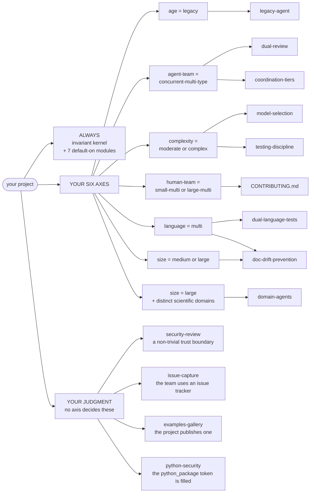

# Dimensions — adapting Cairn to a project

The `doctrine/` tree describes the **invariant core** — what every
Cairn adoption keeps. This tree describes the **adaptation**: how a
specific project, with its specific codebase and team, selects
*how much apparatus* it runs on top of that core.

The principle: the invariant core is small, and every dimension
below *adds* structure only as the project warrants it. A small,
new, simple project run by one scientist with one agent is a valid
Cairn adoption — it runs the core and little else. A large, legacy,
multi-team project runs the full apparatus. The methodology is the
same; the configuration differs.

## The adaptation matrix

A project is positioned on six axes, in two groups. The split
matters: a codebase's size and a team's size are independent — a
5,000-line repository with a PI, three students, and two agents,
and a 200,000-line repository maintained by one person, land at
very different points, and they should.

### Codebase axes — what the software is

| Axis | Range | What it drives |
|------|-------|----------------|
| **Age** (`age.md`) | greenfield ↔ legacy | Whether a retrofit apparatus is needed — a legacy-agent role, a surface-readiness map, characterization testing. |
| **Size** (`size.md`) | small ↔ large | Whether the *code* is partitioned into domains, and whether the role roster specializes by domain. |
| **Complexity** (`complexity.md`) | simple ↔ complex | Review weight and verification depth — how often External review is mandatory, whether a scientific-trust review lens is in the roster. |
| **Language** (`language.md`) | single ↔ multi | Whether a multi-language test architecture and cross-language seam doctrine are needed. |

### Team axes — who builds it

| Axis | Range | What it drives |
|------|-------|----------------|
| **Human team** (`human-team.md`) | solo ↔ multi-human | Decision-authority handling and human-review patterns. |
| **Agent team** (`agent-team.md`) | single agent ↔ multiple agents / types | The role roster, the review tiers, and the coordination tiers (`../doctrine/coordination.md`). |

Each axis has its own document in this directory, and each carries
a **scoring rubric**: the observable signals — module count,
contributor count, language count, test coverage, public-API
surface, codebase age, model risk, agent count — that place a
project on the axis. The bootstrap records a reproducible reason
for each placement, so the configuration is auditable rather than
a judgment call lost to memory.

The matrix is **extensible**: a seventh axis can be added without
disturbing the core.

## The three module layers

What an adoption installs is sorted into three layers. This is
what makes "the invariant core is small" an honest claim.

* **The invariant kernel** — present in every adoption; what makes
  it Cairn at all: the **lifecycle** (proposal → review → decision,
  plus the plan lifecycle for non-trivial accepted proposals); one
  designated Human Maintainer holding final Decision authority;
  append-only, commit-recorded deliberation; stigmergic
  coordination through a `dev/` tree; the baseline coordination
  tier; the session routines.
* **Default-on modules** — installed unless a dimension removes
  them: lifecycle-metrics, reflections, claim-check, fold-back-ledger,
  incident-trackers, documentation-plan, and content-security. (The
  authoritative per-module rationale is the gate table in
  `bootstrap/BOOTSTRAP.md` > I-5.)
* **Team-gated modules** — activated only when the team has the
  structure to run them: the full two-tier Dual-Review apparatus
  with structural-independence floors; the domain-agent roster;
  the legacy-agent role and readiness map; the multi-language test
  architecture; the asynchronous and real-time coordination tiers.

### What your profile actually decides

*A complete six-axis profile does not complete the module selection. Most of
the roster is derived — but four modules are not reachable from any axis:
three are judgments about the project, and one waits on a profile token. If you
fill in the six axes and stop, those four are the ones you silently skipped.*

A team-gated module is not "advanced" — it is simply unstaffable
below a certain team shape. A solo, single-agent team cannot run a
two-agent-type External review; it runs the kernel's review (the
same agent, a fresh session) and gates up when a second agent type
becomes available.

## The minimal viable configuration

The smallest honest Cairn adoption is **the invariant kernel plus
the default-on modules**, with the role roster collapsed to the
Maintainer plus one generalist agent. It runs the recorded,
reviewed lifecycle; it does not run a Dual-Review apparatus it
cannot staff, or a domain-agent roster it does not need.

This is the configuration that makes Cairn adoptable by a small,
new project and not only by a large, complex one. Every axis
position above the minimum *adds* — it never subtracts from the
kernel.

## How the matrix is used

The bootstrap (`../bootstrap/`) assesses a target project against
these axes, writes a **dimension profile** — for example,
"legacy · large · complex · multi-language · multi-agent" — and
selects the role roster, the modules, and the review weight from
that profile. The profile is presented to the Maintainer for
acceptance before anything is installed. The per-axis documents
here are what the bootstrap reads to make those selections; the
case studies (`../case-studies/`) show the matrix applied to two
real projects.
