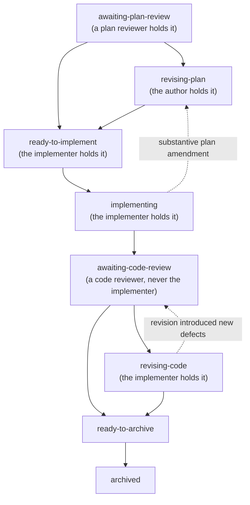

<!-- cairn-internal-ref-allow: docs/methodology/lifecycle.md docs/methodology/dual-review.md docs/methodology/proposals.md reason=docs/methodology/ citation convention -- a doctrine reference is a citation to Cairn's published methodology, not an installed local file (see templates/core/AGENTS.md, "Where docs/methodology/ references resolve") -->

# Plans — type-specific lifecycle doctrine

This page covers the doctrine specific to **plan artifacts**
(`dev/plans/<YYYY-MM-DD>-<slug>.md`).  Shared lifecycle concepts — the Registered
Report analogy, why the record exists, the claim-marker maintenance
exception, deferred-follow-up revival, roadmap management, and
archive preconditions — live in `docs/methodology/lifecycle.md`.
The review stance, the stage questions and how distance is recorded
live in `docs/methodology/dual-review.md`.  Proposal-lifecycle doctrine (triage,
file moves, Response grammars) lives in `docs/methodology/proposals.md`.

Plans execute accepted standard or heavy proposals when plan triage requires
one. They retain the source proposal, applicable plan review and code review,
verification, fences and archive rules described below. Light proposals do
not open a plan; the accepted proposal carries their implementation and final
verification record. There is no parentless change-note route.

---

## The plan lifecycle



The plan-open commit creates the plan and archives the source
proposal. Name the plan `<YYYY-MM-DD>-<slug>.md`, using its opening date. A
plan needs no folder by default; shared tests, scripts and assets stay in
their canonical homes. A separate artifact is allowed only when evidence
genuinely needed for implementation or an existing required safety or security
ceremony cannot reasonably fit in the concise record or its canonical home;
explain why and cite its path in the plan. Do not
create sidecars for reviewer convenience or to evade a length limit. Reviews
accept concise summaries and may verify when necessary. Proposal and strategy files use
`<YYYY-MM-DD>-<author>-<slug>.md`. Retain opening dates when archiving and do
not rename existing archived records. Each status names who holds it next.

* **awaiting-plan-review** — *(only for a review-required plan; see
  the plan-review precondition below)* the plan exists but
  implementation has not started, waiting for its plan-review section
  to land.
* **revising-plan** — before implementation, the author folds plan-review
  findings into operative cells and carries the plan to `ready-to-implement`;
  the original review has one round. During implementation, this status also
  holds a substantive amendment while affected work is stopped pending review,
  author disposition and return to `ready-to-implement`.
* **ready-to-implement** — the review gate is satisfied and work may
  begin. A plan marked `Plan review: not required` may open directly
  here, or at `implementing` when the opening commit already carries
  the implementation evidence.
* **implementing** — implementation commits land.
* **awaiting-code-review** — a code-review pass examines the
  implementation; the reviewer is never the implementing agent.
* **revising-code** — the implementer answers code-review findings; the
  answer carries it to `ready-to-archive`, and back to
  `awaiting-code-review` only when the revision introduced new defects.
* **ready-to-archive** — review has passed and the archive commit is
  owed.
* **archived** — lasting truth has migrated to durable homes and the
  plan moves to `dev/plans/archive/`.

### Completion and human operations

Set a goal first in the existing sections. Scope names the specific result and
why it matters to the accepted objective. Acceptance criteria make completion
observable. Sequence shows available capabilities and prerequisites and gives
a realistic work-window estimate with uncertainty; the estimate is not a
deadline or a waiver. A plan is independently finishable: its implementation,
required checks, reviews and archive finish without another unfinished plan.
Internal chunks may depend on one another, and a coherent helper plus consumer
may share a plan. Do not split work by default or lose accepted scope. A
proposal may retain later outcomes on the existing board with their source and
revival condition until prerequisites are available.
Open work only with its needed authority and resources available. Keep later
outcomes awaiting approval or a passive calendar wait queued on the existing
board with source, owner and restart condition. A ready, resourced scientific
observation remains work even when it spans days; include that duration in the
estimate. The lifecycle guidance covers unexpected permission stops.

A plan reaches `ready-to-archive` when accepted agent-owned scope, required
reviews, applicable checks and change verification are complete. A routine
human-run trust or release operation is not a final plan chunk or a condition
of completion. Record it in a separate named standalone roadmap wait with its
owner, evidence requirement and link to the implementation; do not create a
release plan. The operation remains blocked or unpassed until its own evidence
and authority exist.

Do not move a defect, failed check, missing functional or scientific evidence,
required review, or unexplained integrity failure to a human wait. A reviewed
baseline awaiting a specifically named human operation remains unpassed, not
failed or green. Decision, scope and unexpected-boundary stops remain with the
Maintainer. Archiving does not authorize activation or release. An issue closes
at its fixing commit, not at a later release.

A plan is an *execution* artifact: its status, progress markers,
and commit hashes are updated in place. Review findings and the
archive record are append-only. *(One bounded exception to those
append-only sections: inserting a `claim_check` marker line —
`Proposed/Untracked/External-repo paths:` — adjacent to a path token is
**mechanical maintenance, not authoring a review** (additive-only, its own
labeled `claim-marker maintenance:` commit, typo-guarded). A task-checkbox
/ status update is ordinary mutable workflow, not this carve-out. See
the Mutability rule below and `docs/methodology/lifecycle.md` > "The proposal
lifecycle".)*

**The plan is the Stage 2 of the Registered Report.** Where the
proposal pre-registered the design and the verification plan
(Stage 1; see `docs/methodology/proposals.md`), the plan and its code
review check the implementation and the evidence it produced
against that locked plan. This is the defense against metric
p-hacking the proposal's Stage 1 named: judged against a prior
commitment, not chosen after the fact.

A non-trivial accepted standard/heavy proposal typically spans **5-10 commits**
across the full lifecycle (`accepted` Decision, plan-open,
implementation commits, code-review, sharpening, plan-archive); the
**minimum is 4** (plan-open + first implementation combine, and code
review records inline with the sharpening commit). Trivial accepts
collapse implementation + proposal-archive into a single commit —
they have no plan, so the plan preconditions do not apply.

### Release-gated plans (an expected parked state)

A plan may be explicitly **release-gated** — a phase that cannot fire
until a release boundary has elapsed (e.g. a removal step that waits
on a deprecation clock). Such a plan may remain `implementing` in
`dev/plans/` **indefinitely**, parked between its pre-release and
post-release phases. This is the plan's *designed* lifecycle state —
not clutter, not a hygiene problem; do not "clear" it.

---

## The plan-archive precondition

**A plan never archives until a code review has occurred.** This is
the bright-line rule that makes the review system work end-to-end on
the implementation side — parallel to the proposal-review pass that
makes it work on the deliberation side. Without this rule, fast
implementations escape independent review because the archive commit
closes the loop before any independent eye sees the code.

Concretely, an accepted non-trivial standard/heavy proposal flows through:

```
plan-open (+ optional first implementation)   <- can be ONE commit
implementation (one or more commits)
code-review pass (findings appended in plan; sharpening fixes if needed)
plan-archive (lasting-truth migration; this is what closes the loop)
```

The plan-open and first-implementation commits MAY combine when the
work is tractable in one commit — but only for a plan marked
`Plan review: not required` (see the plan-review precondition below).
The **plan-archive commit, however, is always distinct** from the
implementing commit(s); it is the artifact of "review happened and
the loop is closed." Bundling plan-archive into the implementing
commit hides whether code review actually occurred.

Code review's reviewer is **not the implementing agent** — that is the floor,
and a same-type agent in an independent context clears it. No change to the
plan-review allocation silently adds a reviewer to a code review. Trivial
accepts skip the plan entirely (per the triage rule below) and
therefore do not encounter this precondition.

---

## The plan-review precondition

Symmetric to the plan-archive precondition, at the *entry* boundary:
**a review-required plan does not start implementation until its
plan-review section has landed.** The plan-archive gate guards
*review-before-close*; this gate guards *review-before-implement*.

The gate is **explicit, not remembered**: the `**Plan review**` metadata
line above is mandatory — `required(<obligation>)` or `not required(<rationale>)`,
with **no silent default**. The author states it; the Maintainer ratifies.
When `required`, the plan opens in **`awaiting-plan-review`** and reaches
`ready-to-implement` only after a dated `## Plan review` section lands: the review
**and**, when it raised findings, a disposition (see *The record schema*
below for the two accepted forms and their positional bound).
Its plan-open and first-implementation commits stay
**distinct** (implementation cannot front-run the review). When
`not required`, the rationale is on the record and the plan may combine
plan-open with first implementation.

The statuses and their order are the diagram at the top of this file. A plan
that needs review starts at `awaiting-plan-review`; one that does not starts at
`ready-to-implement`.

Like the plan-archive precondition, this converts a *remembered* norm
into a *structural* one: the gate is a status the plan **carries**, not
an agent's memory (the recurring plan-review-skip failure mode). The
plan header's `Plan review:` line makes the gate legible to a cold
reader; a static plan-review lint is the mechanical backstop (a
`required` plan past `awaiting-plan-review` must carry a dated review
subsection). The plan review is **always a fresh-context, one-round
review**, ruled by the tokens `Internal` and `Internal + Internal Security
Review` — see `docs/methodology/dual-review.md` > "Plan review is Internal, always"
for the full statement, including the `+ Internal Security Review`
obligation a security-sensitive plan declares.

---

## Plan triage rule

**For a standard/heavy accepted proposal, open a plan when its implementation:**

* Will land across multiple commits.
* Touches multiple files / areas (code + tests + docs).
* Has multi-stage sequencing (e.g., infrastructure first, then
  per-target rollouts).
* Carries deferred follow-ups that need a `defer` home before
  archiving.
* Needs Boundary B in `wide` mode (a defect repair meeting the three
  conditions in `docs/methodology/lifecycle.md` is the one exception).

**For standard/heavy, skip the plan when:**

* The implementation is a single commit.
* The change is single-file or single-area.
* No follow-up needs a `defer` home (the proposal's "what's next" is
  fully captured in the implementing commit message).
* Boundary B would run `bounded`. A change that needs `wide` mode because it
  touches a contract or trust-ceremony surface, or its effects cannot be
  confidently bounded, opens a plan with a `## Code review` section. A change
  that skips the plan has no code review. The one
  exception is a defect repair that meets the three conditions in
  `docs/methodology/lifecycle.md` (a failing-test reproduction; it restores
  documented or intended behaviour with no contract change; the touched
  surface's own test family runs in the loop): it stays trivial even on a
  named surface.

The implementing commit re-reads these conditions against what it actually
touched. For standard/heavy, if it touched more than one area, or its Boundary
B would run `wide`, a plan opens then. Light has one short proposal review and
no plan regardless of these conditions; the accepted proposal records its
Boundary B result after the final implementation commit.

For ordinary ceremony uncertainty, use the lighter lane with a stated reason;
newly discovered trust boundaries still stop work for reassessment.

### Fast multi-stage (a sub-pattern of non-trivial)

The triage bullets above are OR-conditions: a plan is warranted when
ANY of the five hold. The common sub-pattern where the first bullet
is FALSE (the implementation itself fits in one commit) but at least
one of the others holds (touches multiple files / areas, has
multi-stage sequencing, carries deferred follow-ups, or needs Boundary B
in `wide` mode) is called **fast multi-stage**.

Fast multi-stage compresses the implementation phase into a single
commit but does **not** collapse the lifecycle. Plan-open + first
implementation may combine in one commit (per the plan-archive
precondition above); plan-archive remains distinct. The minimum
lifecycle is **three commits past the implementing combined commit**:

```
commit N:    plan-open + implementation       (status: review)
commit N+1:  code review + sharpening
commit N+2:  plan-archive + lasting truth
```

Ordinary multi-commit plans are not fast multi-stage, but they use
the same review-before-archive guardrail.

---

## Mutability rule

Plans keep four operative cells current throughout active work: Scope, Sequence,
Acceptance criteria and Verification. Status, progress markers, commit IDs,
verification notes and moved link targets also update in place. Reviews,
responses, plan amendment reviews and decisions append and are never edited.
An archived plan is closed except for link maintenance.

A substantive change to an operative cell during implementation stops affected
and dependent work. Return the plan to `revising-plan`, append a change-log
entry, review the changed design, record the author's disposition, then return
to `ready-to-implement` before resuming. Wording or status changes that alter
no obligation need no amendment review. Missing design returns to the existing
operative cells; no sidecar is created.

Each `## Plan change -- <author> -- <date>` entry uses `**Prior reviewed
commit**`, `**Replacement commit**`, `**Affected cells and dependencies**`,
`**Change**`, `**Reason**` and `**Required obligations**` (exact `Internal` and/or `Internal Security Review`
strings joined by ` + `). IDs are full 40- or
64-hex Git object IDs. The revision commit may mark the
replacement `this commit` while status is `revising-plan`; the next plan-only
metadata-fill commit replaces the marker with that revision SHA in the same
entry before review. The fill is not another revision. The first prior ID is
the original full-review target; each later prior ID is the preceding amendment
replacement, not a review or disposition commit.

List affected operative headings and dependent chunk IDs as a comma-separated
set without duplicates; each review repeats that exact set. Each required
obligation gets one `## Plan amendment review -- <reviewer> -- <date>` record
with the same prior/replacement pair and set, one exact `**Obligation**` and
one `**Verdict**`. The first prior ID must match the full ID in the original
plan review; later entries link directly to the preceding replacement. A short
legacy `Reviewed commit` remains valid for ordinary review, but cannot
establish an amendment baseline, so selection stops rather than guessing.

Every attempt needs a complete, unambiguous set of reviews. A latest set with
REVISE selects only author revision while status is `revising-plan`. A
successor must name that rejected replacement as its prior, carry forward the
union of unresolved affected entries and required obligations, and add its own
changes. Its reviews are fresh; earlier ACCEPTs never transfer. Missing,
extra, duplicate, conflicting, mismatched, narrowed or skipped records stop
selection. The latest revision is actionable only after every required review
is ACCEPT and its paired author Response records
`**Disposition**: ready-to-implement`. Security Review passes across
replacements count toward the existing cap; a successor does not reset it.
The text-only advisory reader compares IDs and order without Git or proof of
SHA ownership; consistently forged IDs are not detectable. Changed
Verification or dependencies cannot inherit approval. Original and historical
reviews remain distinct and unchanged.

Plan reviews still have one round. This amendment path is for substantive
changes during active implementation, including changed Verification or
dependencies; a prior ACCEPT cannot be inherited for those changes. Plan
review findings before implementation are folded into operative cells under
the ordinary plan-review transition.

---

## Implementation verification boundaries

A plan maps verification to three boundaries. Change verification covers the
known behavior and acceptance criteria of the change; certification states
the scope supported by its evidence. Repeating
one broad command is not independent review.

### Boundary A — Iteration (scoped)

For each changed file, `python tools/test_tiers.py for <paths>` lists tests
that import it or cite its path or file name. For `AGENTS.md`, include the full
reviewed commit range with `--range BASE..HEAD`. Run that list while iterating;
do not widen it by judgment. Run applicable standing prose gates for prose.
For governing text, when the broad reader list exceeds 40, use only tests
pinning the changed passages and report every omitted reader. Folder sweepers are
covered by the release run. Unknown dependencies are not claimed as covered.
A known required path, check, or acceptance criterion that remains unmet keeps
the change open.

#### Choose checks from affected promises

Begin with component ownership and the project's existing test homes. Unit
checks cover local behavior; contract checks cover public interfaces and data
formats; integration checks cover connected components; a small workflow
checks the real entry point. For simulations, use real equations on small
domains and analytical or convergence benchmarks when relevant. Keep
work-specific long runs where the scientific question requires them; runtime
alone does not establish coverage.

Write criteria as observable behavior, not internal implementation. Optional
prompts are the condition, observable behavior, behavior that must remain
unchanged, and the check that demonstrates the result; EARS is optional. A
prompt does not replace accepted scope or required checks.

The implementing agent traces changed behavior through callers, imports,
configuration and data readers, and public paths, then maps existing checks to
affected components and consumers in the implementation record. Local effects
default to affected checks. Shared contracts, common infrastructure,
cross-language seams, solver or physics behavior, and uncertain dependencies
widen to owning test families and relevant consumer or integration paths. Add
or extend tests only for a plausible uncovered fault. If dependencies are too
tangled to bound, name the missing seam and the smallest useful remedy; optional
architecture review remains available but is not required for each change.
Agents make this routine mapping; independent review challenges the selection
within the existing lifecycle. Maintainers set high-level project needs and
material exceptions, not per-change coverage. An unresolved known check keeps
the work open.

Routine project operations use affected checks. At integration or release
boundaries, recommend a representative cross-component workflow and name
applicable safety, security, scientific, and release checks in the project's
existing commands. A whole suite remains optional unless a project requirement
makes it mandatory; preserve every already-required check.

**Certify a stated scope.** Existing work records name the tested commit,
components, checks, results and omissions. A scoped certification covers only
those behaviors: unrelated components, untested combined behavior and earlier
changes remain unclaimed. Reopen a claim when a later failure contradicts it.
Required project checks and ceremonies remain owed, including any required
full suite. Cairn itself retains its full-tree certification pair and triggers
in `AGENTS.md`; its green run certifies every change at or before that commit
for bisect. Nothing is pushed when a required certifying run has not passed.

Scientific model evidence is recorded with the work or release that requires
it. A model run is not added to routine tree certification merely because it
produces scientific evidence. A configured suite member remains required at
each required point, as do all applicable acceptance, safety, security and
release checks. Subject or duration does not waive or reschedule a requirement;
that needs separate authority. This distinction leaves the configured suite,
its commands and its certification triggers unchanged.

Work confined to ordinary prose or deliberation records runs the applicable
claim, link, snippet, schema, and neutrality gates rather than an unrelated
engine suite, on any surface, a high-risk one included. When a search finds no
test or manifest that pins the prose, its record is the gates run and that
search, in place of a bounded record. Executable snippets, generated or frozen
fixtures, gate manifests, and contracts whose plans name test coverage are not
ordinary prose.
A **substantive surface** is anything that is not ordinary prose under the
prose-only rule: code, tests, executable templates and snippets, fixtures,
manifests, and prose a test or manifest pins.

### Boundary B — Integration (one stable change-verification record)

After code review, or after the final implementation commit when no code review
applies, the implementer runs one final integration selection on a clean,
stable commit using the configured canonical interpreter/runtime. It includes
the iteration list for every file in the reviewed range, plus integration and
workflow tests in the tier map that name those files. Record
`**Boundary B mode**: bounded | wide`.
`bounded` covers mapped affected behavior and consumers. `wide` covers the
owning test families, known cross-surface integration and public paths, and
standing gates when effects cannot be confidently bounded. Use `wide` for a
contract or trust-ceremony surface. Neither mode claims unknown dependencies
are covered. A contract change covers its producers,
consumers and public paths; a trust ceremony retains every prescribed security
and ceremony check. Missing known coverage or an unmet criterion keeps the work
open; certification cannot fill that gap.

Timing targets are 30 seconds for iteration, 10 seconds per test file, 3
minutes for integration, and 10 minutes for certification. They are diagnostic,
not agent scores; a miss does not block work. Record misses and add each test
file over 10 seconds to the test-consolidation list, slowest first.

If a required selection crosses the test runner's file limit, split it into
invocations within the limit. Record each invocation's arguments and outcomes,
the executed-test union, and its reconciliation with the original collected
selection. Preserve markers and shuffle seeds; never use the full-suite
override to get around the limit. Collection alone is not evidence that a split
ran.

The mapping is adjudicated by Boundary C, not by a tool that can only confirm
that fields exist. The independent reviewer records
`**Bounding**: ACCEPTED | WIDER RUN REQUIRED` after challenging a named surface,
mapped test or stated omission. The second verdict names the missing behavior
and check. The author runs that check and records new final-commit evidence
before acceptance; otherwise the work stays open.

**Boundary B governs every implementation, a trivial change included.** A
trivial change uses the same file-name selector rather than searching readers.
Boundary C, when required, is targeted review before Boundary B; it never runs
a suite. For a light proposal without a plan, append Boundary B evidence to the
proposal after its final integration selection, then archive it. A later fix
after a failed selection that changes more than the failing test returns to
the same reviewer for a targeted look before rerunning the integration
selection. The defect-repair exception remains governed by the lifecycle's
three conditions.

**An already-open plan may switch to this contract by one line in its record.**
Until it does, its written checks govern. A plan that already requires a
whole-tree run stays open until an authorized certifying run covers it or that
plan is revised. Plan templates apply prospectively; archives are not
retrofitted. A plan receives its implementation-verification record only after
the run completes:

```markdown
## Implementation verification -- <agent> -- YYYY-MM-DD

**Boundary B mode**: <bounded | wide>
**Tested commit**: <full revision ID>
**Reviewed range**: <base revision>..<tested endpoint>
**Interpreter/runtime**: <path and version>
**Pre-run state**: <clean tree; HEAD = tested commit>
**Post-run state**: <clean tree; HEAD = tested commit>

| Command | Exit | Outcomes | Elapsed | Tokens |
|---|---:|---|---:|---:|
| <mapped tests, standing gates, and acceptance commands> | <code> | <pass/fail/skip/xfail/xpass counts> | <time> | <count or unknown> |

**Non-pass disposition**: <explicit disposition; ordinarily none>
**Plan-specific acceptance commands**: <commands and results>
**Known omissions**: <what this evidence did not exercise>
**Benefit versus cost**: <verdict> -- <benefit>; cost <measured>; remaining burden <measured>
```

Do not place an empty Implementation verification heading in a newly opened
plan: an empty section looks like landed evidence. The record is committed in a
later plan-only commit, so live `HEAD` may advance without changing the tested
implementation bytes. Close the record with a revisit condition and the countable
benefit-versus-cost line shown above. Use the implementation-to-tested range
for Git counts and net burden; report available decision counts,
shipped/always-loaded word changes, test count/runtime and installed-file
deltas from existing records. Distinguish aggregate agent elapsed from wall
time, and say `unknown` when evidence is absent. This is retrospective, not an
archive gate.

Record each actual tree-certification run once in its existing evidence home.
For a release cut or re-anchor, use that ceremony's existing evidence record.
For a required push or Maintainer-requested run outside those ceremonies,
include a `Tree certification -- <tested SHA>` section in a useful commit
message in shared project history; do not create a commit solely for the
record. Include the tested SHA, commands, results, and the evidence required
for that run, including failures. Readers can search fetched shared history
with `git log --all --grep='Tree certification --'`; this searches only refs
available locally. The evidence record is separate from change verification.
Do not backfill archived plans. An absent record does not prove a run passed.

A plan's record is valid only when the tested commit contains the entire
reviewed range, pre/post `HEAD` both equal the full tested revision, and the
tree is clean before and after. A later review or record-only commit does not
invalidate it.
A later unrelated implementation commit neither falsifies what the record says
about its named tree nor gains coverage from it. Boundary B follows code review
and covers its fixes; a change made after that final integration run requires
replacement evidence.

This is a human-readable process attestation under a trusted-contributor model,
not a signed receipt or parser-enforced claim. It does not authenticate the
author or prove the commands ran. Release verification is a separate ceremony:
an implementation record never satisfies or shortens a release gate.

### Boundary C — Falsification (targeted review before B)

Code review reads the iteration evidence and runs only targeted checks that
could falsify the change. It does not run a suite. A review finding names the
missing behavior and check; the author adds it, and the final integration
selection covers it. A fix after a failed integration selection that changes
more than the failing test returns to the same reviewer for a targeted look.
A ceremony keeps every prescribed check, and whole-tree evidence comes from a
separate authorized certifying run, never from a reviewer's rerun.
This process does not automatically call for a whole-tree run.

A replacement Boundary B record is required when any of these six
record-replacement triggers applies:

1. no valid Boundary B record exists;
2. review discovers an unrecorded cross-surface dependency;
3. a skip, xfail, or xpass lacks an adequate disposition;
4. a later change is made after a valid final integration record;
5. the accepted plan's trust ceremony explicitly requires independent full
   execution; or
6. the reviewer has a concrete reason to distrust or falsify the broad result.

These triggers require scoped change evidence again; they do not automatically
call for a whole-tree run. The fifth trigger is satisfied only by the
authorized ceremony's prescribed certifying run.

---

## The planning handshake

Before heavy implementation, the team converges on a short set of
questions — a lightweight handshake for plan-shaped work below the
full-proposal bar (a proposal answers these at greater depth; a plan
draining an accepted proposal inherits most of them):

* What workflow or capability are we improving?
* What is the current pain or risk?
* What contract or module boundary is involved?
* What would success look like?
* What tests, docs, or examples prove the change?
* **What must explicitly *not* change in this pass** — the scope fence?

The `## Scope` section in the plan template is where these land: it
names what the plan executes *and* what it deliberately leaves alone.
The scope fence is the load-bearing one — an unstated "not this pass"
is how a bounded plan quietly grows.

### Accepted scope is a floor — the scope fence is not a licence to shrink

The fence bounds *this pass*. It does not bound the **accepted
proposal**, and the difference is the whole of this rule.

Before a Decision, reducing a proposal is a design change the Maintainer
can see and accept or reject. **After** an accepted Decision the
proposal's scope is the authority the plan drains. A plan that carries
only A from an accepted A+B+C proposal has not chosen a tidy scope
fence — it has **deviated from approved scope**, and `AGENTS.md`
already gates deviation.

So, post-Decision:

* **The baseline is the scope as accepted.** Judge any narrowing by the
  outcome test (`dual-review.md` > "Review expectations — the
  scope-reduction trap"): `preserved` owes nothing; `degraded` or `lost`
  takes the declaration, the grouped scope-remainder record, and the
  Maintainer's explicit disposition under the deviation gate.
* **Sequencing is free; removal is not.** Moving work between chunks
  of a live plan, re-ordering them, or splitting one across commits
  changes no outcome and owes no declaration. Dropping an accepted
  outcome does.
* **Work handed to a plan that is not open yet is a `defer`.** A pointer
  to an unopened plan is not a home (`lifecycle.md` > "Archive
  precondition"), so the hand-off takes a board row listing the items,
  deposited with the Maintainer's authorization quoted. When the accepted
  text **assigns** that work to the later plan, quoting that sentence and
  the Decision is the authorization. A plan that simply fell short has no
  assignment to quote: its remainder comes to the Maintainer in the archive
  batch.
* **A plan reviewer cannot create that authority by calling the
  remainder "out of scope."** A reviewer may recommend a reduction and
  must state what is lost; only the Maintainer may concede it.

A **plan-review Sharpening** is where this most often bites, because a
narrowing recommendation and its acceptance land in the same section.
The Sharpening carries the `Scope delta` when the disposition it records
degrades or loses an accepted outcome.

This adds no new approval step. The deviation gate is the existing
authority point; doctrine only has to say that removing accepted scope is
one of the deviations it governs, alongside new scope, a revived struck
chunk, a contract the review never saw, and an acceptance criterion the
implementer cannot meet.

---

### Defect fixes inside the existing work

A defect fix made under `AGENTS.md` > "Working tree and commits" is
not new scope. That operational rule is the authority; an issue or a review
note cannot manufacture a promise or authorize changing a rule. The code
reviewer lists `Defect fix:` lines in the reviewed range and checks each
against the promise, the existing file scope, its test and the stated fence.
There is no date cutoff. A growing total approaching a chunk's worth is a
warning to inspect scope, not a hard quota or permission earned by staying
below one. Findings on the plan's own change still land as sharpening fixes.

---

## Forward-reference paths — `Proposed paths:` marker doctrine

A plan typically cites paths it *plans to create* during chunk
execution (new modules, new test files, new docs). At plan-open time
those paths do not resolve, so `claim_check` hard-flags them. The
escape hatch is `claim_check`'s marker-line mechanism: a line that
begins with `Proposed paths:` (case-insensitive; optional list-item
prefix) exempts path and line-bounds tokens on that line from the hard
checks. Each literal path declared on the marker line may also recur
anywhere else in the document when it does not resolve locally.

Use the marker when:

* The plan opens with paths it plans to create at chunk commits.
* The plan cites future test files, fixture files, or documentation
  files in chunk tables.
* The plan moves a file — the future archive path is forward-reference
  until the move happens.

Marker shape (preferred): one or more `Proposed paths:` lines near the
top of the plan (after `## Plan triage rule`, before `## Scope`), each
listing a batch of related tokens. Multiple tokens per line are fine;
each backticked token on the marker line declares a path. The line's
declared literal paths may recur anywhere else in the same document, and
each exempted occurrence is reported with the declaration that
authorized it. The marker line and any contiguous structured rows
(table rows, list rows, or bare backticked path-list rows) are exempt
from hard path and line-bounds checks until a blank line, heading, or
ordinary prose line. Each continuation row declares only its first
backticked token; later tokens in that row's explanation are not
declarations. A standalone marker line still declares its paths for
document-wide reuse.

Example:

```
Proposed paths:
- `path/to/new_tool.py` -- a new module.
- `path/to/new_dir/` -- a new directory.
- `path/to/new_doc.md` -- a new document.

Chunk A creates `path/to/new_tool.py` in `path/to/new_dir/` and documents it in `path/to/new_doc.md`.
```

**Document-wide reuse is exact and fail-closed.** A declaration exempts
only the identical literal path in the same document when that path does
not resolve locally. It never exempts a sibling, descendant, or
look-alike prefix. A wildcard or placeholder is not a literal
declaration; a conflicting declaration under another marker keyword
grants no authority. Do not reuse a declaration after its path resolves:
existing files and stale line-bounds citations remain subject to the
hard checks. Use a marker line or structured marker block when a
declared path recurs in ordinary prose (a chunk description or
acceptance criterion). On a mutable lifecycle artifact
(`dev/proposals/<name>.md` or `dev/plans/<name>.md`, not an
`_template.md`), each checkable declaration in a structured block is
subject to liveness: its path must not have materialized, and it must
authorize at least one would-be missing-path or line-bounds exemption
outside every marker line and block. A path the
checker cannot resolve is reported informationally because liveness
cannot be evaluated; a path now resolved by the exact lifecycle archive
rule is a non-failing migration diagnostic. Files under
`dev/proposals/archive/` or `dev/plans/archive/`, proposals with terminal
status (`accepted`, `rejected`, `superseded`), and plans with terminal
status (`archived`) are immutable, so their liveness findings are
informational. A missing or invalid status does not make an active
artifact immutable. A standalone marker line declares paths
document-wide but carries no separate liveness obligation.

**Two other marker keywords** parallel `Proposed paths:`:

* `Untracked paths:` — for git-ignored paths a fresh checkout will not
  carry.
* `External-repo paths:` — for paths that resolve in a sibling
  repository this project depends on, or an upstream framework
  checkout, rather than in this tree.

All three marker keywords use the same exact document-wide rules.
See `claim_check`'s module docstring (the "Typed-declaration registry"
subsection) for the full mechanism and provenance rules.

**Applies to a plan's append-only finding sections too.** Under the
`AGENTS.md` claim-marker-maintenance exception, inserting a marker line
to clear a forward-reference / sibling-repo path flag is permitted even
inside an append-only `## Plan review` / `## Code review` section (and a
reviewer's findings) — additive marker line only, in its own
`claim-marker maintenance:` commit, with no change to the finding's
text. A plan's **task checkboxes / status** are ordinary mutable
workflow, distinct from these append-only finding sections. Before
marking, confirm the flagged path is not a typo of a real local path.
**Placement safety**: a marker block exempts its contiguous structured
rows and lets each row's first path become an exact document-wide
declaration. A marker line's paths also declare exact paths document-
wide, even without continuation rows. Put only intentional declarations
in the block, then leave a blank line after its rows. For many
sibling-repo paths, prefer the file-level
`<!-- claim-check-allow: <glob> -->` directive (narrow globs only).

---

## Count claims — the three-kind precision / `as_of` discipline

A count is not one thing.  Before writing a number into a durable
artifact, decide which of **three kinds** it is — each wants a
different treatment, and getting the kind right is what removes the
need for exact counts (and the stale-count drift they invite) at the
source:

* **Decision-irrelevant** — the number is colour, not the point ("the
  largest file by far", "ships in a few commits").  **Approximate it**
  (`~4900 lines`, "2-3 commits").  Chunk-table commit estimates are
  almost always this kind.  An exact count here is a maintenance
  liability with no upside: it drifts, and nothing depended on its
  precision.
* **Dated snapshot** — a measurement true *at a moment* the artifact
  records as evidence ("the suite had N tests when this plan opened").
  **Date it** (`N tests, as_of YYYY-MM-DD`) and **never re-measure
  it** — re-running *erases* the evidence the snapshot is.
* **Live invariant** — a current size cited as present fact, prone to
  drift.  This is the one number worth an exact value *and* worth
  machine verification: register it and re-measure it (the code-side
  `verify_counts` registry, where the project ships one).

"The safest stale count is the one prose did not need."  Most numbers
are decision-irrelevant; approximating them is the cheapest and most
durable fix.  Reserve exact counts for snapshots (dated) and invariants
(registered).

The write-time count soft-flag and its `claim-check-allow-count`
directive were **retired 2026-06-05** (0 catches across the
verify-before-asserting instance log; the nag generated header bloat).
`claim_check` no longer flags counts — a stray
`claim-check-allow-count` comment in an archived artifact is silently
ignored.

---

## Plan review — doctrine and format

*A fresh-context review pass on the plan itself before implementation commits
land. The original plan review has one round; findings are appended and folded
into operative cells. Substantive amendments during implementation use the
separate amendment review path in the Mutability rule above.*

### Internal, always — the plan review is one fresh-context pass

**A plan review is fresh-context — always.** No plan review is a
mandated read from a different agent type, a recommendation slot, or an
escalation target; there is nothing to inherit or invalidate, because
there is one review to declare. A plan that only translates
already-reviewed decisions does not pay for a second read of the same
design.

Within the three stage questions, check that each chunk has enough design for
its assigned model tier to execute without the implementer making design
decisions. Name any missing specification and return the chunk to its author;
a stronger implementer is not a substitute for a complete plan.

Two consequences worth stating plainly:

* **Assurance path does not change the plan review.** High
  assurance keeps governing verification, Security Review, scientific
  review, protected-surface handling, risk acceptance and ceremonies;
  it does not buy, or owe, a different-agent-type plan round.
* **A plan whose surface or triggers call for security treatment**
  declares the obligation as `Plan review: required(Internal +
  Internal Security Review)` — a distinct obligation, satisfied only
  by an appended `## Plan review` pass whose `**Obligation**:
  Internal Security Review` line matches it, never by an ordinary
  Internal pass and never by a record merely titled `## Security
  review (...)` -- the heading text carries no mechanical weight.
  Full contract: `docs/methodology/dual-review.md` > "Plan review is
  Internal, always".

### When to use it

* **Maintainer-requested** ("I'd like a review or two before this moves
  forward").
* **Plan revised mid-flight** — when a discovery-driven revision
  materially expands scope or adds chunks, a review pass on
  the revised plan is worth running before chunks land.
* **Scope is large or load-bearing** — many chunks, multiple modules,
  scientific / architectural risk that the proposal review didn't fully
  resolve.
* **Plan author wants a second eye** — always defensible; the cost is
  low and the failure mode it prevents (implementing against a flawed
  spec) is expensive.

Skip plan review when the plan is small, derived directly from a
proposal that itself went through review, and the implementing
chunks are straightforward. Trivial accepts that skip the plan entirely
(per the Plan triage rule above) also skip plan review.

### Reviewer identity

**The plan review's floor** — a fresh session is sufficient, and it is
also the ceiling a reviewer may prescribe: the plan is a deliberation
artifact (parallel to the proposal Review section), not implementing code,
and a plan review never escalates, by a reviewer's choice, to a read from
a different agent type. The Code-review floor below (**not the
implementing agent**) applies to *implementation* review, not here.

A plan whose surface or triggers call for security treatment declares
the `+ Internal Security Review` obligation (see "Internal, always"
above) — still a fresh-context session in the Security Review role, and
no different agent type is required. The Maintainer may still choose to
ask any additional reader for a plan; that choice is never a tier and is
never inferred from the plan's size or subject.

### Format

The current plan template supplies the review record. Each pass identifies its
reviewer, basis and obligation, answers the three Foundations questions with
evidence, gives its findings and verdict, and names coverage and omissions.
The author responds to findings; readers check that each required obligation
is met. No retired checker attests that a review occurred.

### Multi-round review

A plan review has one round; the fold carries the plan forward and no
second plan-review pass is run. The only plan-stage pass that may recur
is a **Security Review**, which normally takes at most two passes to close the
obligation it was raised against. A further pass requires a specific unresolved
security question or newly changed material, why earlier passes and evidence
cannot resolve it, expected value, the named artifact and scope, and explicit
Maintainer authorization for that pass; each later pass needs new
authorization. Without these, the cap stands. An unresolved blocker or unmet
accepted criterion/check at the cap goes to the Maintainer by name and does not
clear automatically. Each pass gets its own dated subsection with a round
suffix:

```
## Plan review -- <reviewer> -- YYYY-MM-DD (round 2)
...
### Sharpening -- <author> -- YYYY-MM-DD (round 2)
...
```

Finding numbering restarts per round (`N1`, `N2`, ... in each round);
cross-round disposition citations reference the round explicitly
(`N1.r2 accept`).

### Distinct from discovery-driven plan revision

Inline plan revisions driven by *implementation discovery* — e.g., the
implementing agent realizes the original plan's chunk shape was
incomplete — do NOT require a `## Plan review` section. No review
happened; the audit trail lives in the revision commit's message + the
git diff. Use this section only when an actual review pass
occurred.

---

## Code review — doctrine

*Filled in after implementation commits land.* Begin with
`**Model**: <model or tier when known>` immediately below the section
header (or below a `### Code review -- <reviewer> -- YYYY-MM-DD`
sub-heading if used). The reviewer is typically NOT the implementing
agent (the one Reviewer role applies, same as
the proposal Review section). Findings as a numbered list with
`accept (commit <sha>)` / `guard (<path>::<node>)` / `defer` /
`wontfix` dispositions.
Sharpening fixes land as follow-up commits before the plan archives.
A cheap follow-up is a few person-steps, needs no new Decision or public name
beyond the plan, and has a test that fits existing test files. Code review
identifies cheap findings and advice; the author fixes each in the response
before archive or uses an existing deferral reason with the Maintainer's
verbatim authorization. Cheapness grants no scope, boundary or required-check
waiver, and does not expand the narrower cheap defect-fix exception in
`AGENTS.md`. Non-cheap advice retains its existing disposition. Required failed
checks remain implementation work; a reviewer's suggested home alone is never
authorization to defer.

**A clean code review is concise and evidence-backed.** The reviewer points to
reproducible tests or scripts and states their outcomes and remaining uncertainty;
plans and review records do not carry probe or mutation inventories. For a claim
about every member of a set, derive the set from the tree and mutate each member
in a separate copy using repeatable checks. Report briefly whether checks caught the breaks and
whether any mutation remains unresolved or unmeasured. Equivalence is measured
when a behavior test through the real entry point passes under mutation.

**End with the coverage line** (`docs/methodology/dual-review.md` > "The coverage
line"): **Covered** (what the pass examined, with evidence) / **Not
covered / low confidence** (the negative space). Keep this honest and concise;
coverage is not an inventory of probes.

**Reviewer identity**: the "not the implementing agent" default is
the FLOOR for code review — stricter than the plan review's
fresh-session allowance. Rationale: proposal review surfaces
intellectual flaws in ideas; code review surfaces implementation
regression risk where the implementer's just-written code is harder to
spot mistakes in cold by someone with the same underlying reasoning
patterns. If the implementation carries scientific or architectural risk
not fully resolved during proposal review, the reviewer says so in the
coverage line and the Maintainer decides whether to ask for more
distance; the reviewer does not prescribe it.

This section is append-only once a reviewer has added findings.

---

## Lasting-truth migration doctrine

*Filled in at archive time.* Per the archive preconditions rule in
`docs/methodology/lifecycle.md` > "Archive precondition", plans archive only
after every deferred follow-up carries a **recorded disposition** —
`accept`, `guard`, `wontfix`, or (with the Maintainer's quoted
authorization) `defer`. A `defer` needs a durable home outside the
plan; the other dispositions are the home.

**"The disposition is the home" holds only when the disposition
landed somewhere a reader will meet** — a commit, a comment, a test,
a doc. That is the ordinary case for a fixed defect. It is *not* the
case for an observation, a lesson, or a design gap: recording one in
the plan and marking it `accept` leaves it in a file that is about to
stop being read, which is the opposite of migration. **An item with
no landing place outside the plan is a `defer`, and needs a board row or an
entry appended to the receiving open plan.**

**An append re-opens the attestation.** This section is filled at
archive time and is append-only afterwards, so it accretes — and an
attestation that was accurate when written can be false by the time
the section around it grows. If you add anything here, re-read the
disposition line and restate or amend it. `Dispositions: none` is a
claim about the whole section, not about the moment it was typed.

Acceptable `defer` homes:

* `dev/PLANNING.md` — a tier item, a follow-up backlog, or a new
  dedicated subsection.
* The receiving open plan's named section, with the item actually appended
  and the Maintainer's quoted authorization covering the added scope.
* A topic doc's "Future work" section.
* `CHANGELOG.md > Unreleased` — the user-visible release-facing
  summary.
* Its own queued follow-up proposal at
  `dev/proposals/<YYYY-MM-DD>-<author>-<short-title>.md`.

The local next-session note is not an archive-time home — it is
written only at the goodnight routine. A small, pickable-cold
follow-up goes to `dev/PLANNING.md` here; the goodnight note may then
point at that row.

**The archive commit writes its own changelog entry.** `AGENTS.md`
already makes an archive a serialization point for the changelog, so the
plan's line is written in that commit and not left owed to the next
goodnight. Two archives on the same day take the required signal and read
for a coordination-surface file (`docs/methodology/coordination.md` > "Required
signal+read for coordination-surface files"). The goodnight still
verifies the changelog.

The archive commit body must name each item's disposition, in the
form:

```
Dispositions:
* <item> -> accept (fixed in <chunk>)
* <item> -> guard (tests/test_thing.py::test_the_case)
* <item> -> wontfix (<rationale>)
* <item> -> defer (<reason>) -> dev/PLANNING.md > <section>   [Maintainer: "<quote>"]
* <item> -> defer (in motion) -> dev/plans/<YYYY-MM-DD>-<slug>.md > <section>   [Maintainer: "<quote>"]
```

The older `Follow-ups migrated to:` spelling remains valid and is
still recognized; artifacts archived under it are correct as they
stand and are never rewritten.

This makes the migration auditable from `git log` alone.

The archive-time migration note must also include an **evidence
ledger**:

* **Evidence shipped** — tests, docs, examples, or workflow checks that
  actually landed in the implementation / sharpening commits.
* **Evidence deferred** — planned checks or workflow smokes that did
  not land in this plan.
* **Deferred evidence home** — where each deferred item is now tracked
  (`dev/PLANNING.md`, a topic doc's "Future work" section, or a queued
  follow-up proposal).

This prevents the archive commit from accidentally turning "deferred"
evidence into "shipped" evidence by implication.

The migration note must also carry the **loop-fidelity sign-off** (the
Decision→implementation checkpoint; see `docs/methodology/lifecycle.md` >
"Loop-fidelity verification"):

* **Fidelity sign-off** — confirm the **landed implementation commit(s)
  match the accepted Revised section**, and **name which Revised section
  governs**. Make it falsifiable: cite the commit sha(s) and the governing
  section, not a bare "matches." A missing sign-off line is a code-review
  finding (like an unfilled slot). For an upstreamed (Cairn-side) change,
  cite the landed Cairn commit.

This section is append-only once written.
