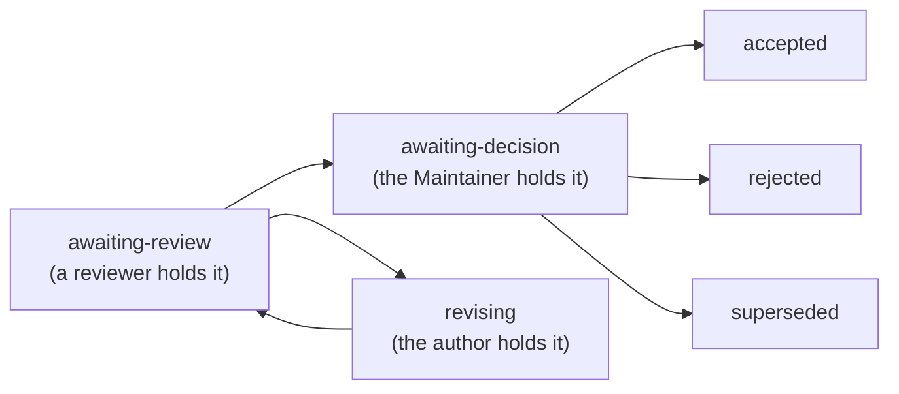
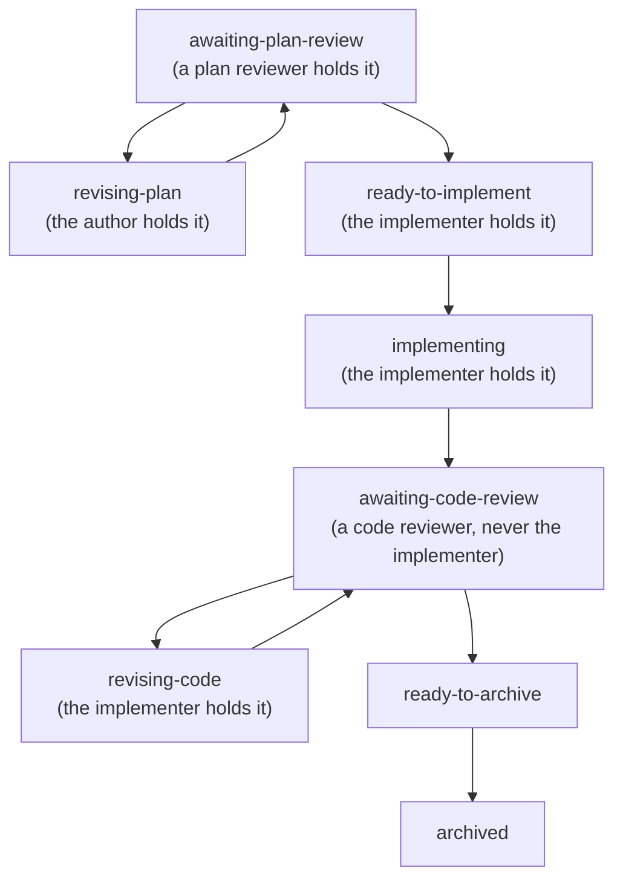

<!-- cairn-internal-ref-allow: doctrine/lifecycle.md doctrine/proposals.md doctrine/plans.md doctrine/dual-review.md doctrine/session-routines.md doctrine/roles.md reason=doctrine/ citation convention -- a doctrine reference is a citation to Cairn's published methodology, not an installed local file (see templates/core/AGENTS.md, "Where doctrine/ references resolve") -->
# The lifecycle contract

This document is the **executable formalization** of the lifecycle —
the legal states, the legal transitions between them, the **authority**
each transition requires, and the **per-type precondition** each
transition must satisfy. It does not restate *why* the lifecycle is
shaped as it is; that reasoning lives in
[`lifecycle.md`](lifecycle.md), and the per-artifact prose contracts
live in [`proposals.md`](proposals.md) and [`plans.md`](plans.md). This
contract **references** those homes and renders their rules in a single
machine-checkable form, so a tool can report an artifact's state and the
preconditions a transition has not yet met — **without** re-litigating
or fragmenting the doctrine.

It is the foundation two things read against: the **read-only
checker/planner** (`templates/skills/_lib/lifecycle_planner.py`), which
reports state + legal transitions + unmet preconditions and emits a
*proposed* scaffold for a chosen transition; and the **conformance
test** (`bootstrap/tests/test_lifecycle_contract.py`), which guards this
contract's executable form Cairn-side.

## The authority contract — the safety boundary

A tool may **mechanize the assembly, the gates, and the formatting**; it
must **never mechanize the judgment**. This boundary is what lets
mechanization *serve* the deliberation instead of eroding it, and it is
stated here as a contract, not an aspiration:

1. **Structural attestation, not authenticity.** A tool **attests the
   structure and presence** of an authority-bearing artifact — a
   blockquote is present, visually isolated, and matches the commit
   message — and reports a *missing or malformed* one. It **never
   certifies authenticity**: a local tool has no access to the harness's
   chat or system logs, so it cannot know whether a quoted authorization
   was truly given. The **committing harness/operator remains the sole
   guarantor** that the quote is real. The tool reports a missing
   attestation; it never asserts a valid one.
2. **Infer, validate, quote — never invent.** A tool may **infer**
   structural state from committed artifacts, **validate** attestations
   those artifacts carry, and **quote** authority-bearing inputs. It may
   **not invent** them: it never authors a disposition, a finding, or an
   authorization.
3. **A status flips only on a machine-verifiable precondition.** When the
   documentary precondition for a transition is absent, the tool reports
   the **missing attestation** rather than guessing the transition is
   legal.
4. **The visible pause is preserved.** Mechanization prepares and quotes;
   an agent or the Maintainer owns the transition. The tool's output is a
   *proposal* — a scaffold and a manifest of what would change — not a
   mutation and not a commit.

The read-only checker/planner honors this contract by construction: it
**reports and proposes; it does not write the corpus and does not
commit.** Any future mutating arm is a separate, separately-reviewed
privilege (see [`lifecycle.md`](lifecycle.md) and the proposal that
defers it); this contract governs what such an arm would have to honor,
but the read-only program neither needs nor claims that privilege.

## Identity: AI reviewer vs. human authority

Several preconditions turn on *who* authored a section — a review is
authored by a reviewer (an AI agent or a human), but a **Decision** is a
**Human Maintainer** authority. The contract distinguishes them by an
**extensible, vendor-neutral identity model**, never a closed enum:

* The author token is parsed generically from the section header
  (`## Review -- <name> (<role>) -- <date>`), preserving the real
  identity (`Codex`, `Claude`, `Antigravity`, `Gemini`, a future agent).
* Classification is **three-way and positive**, never a denylist
  residual: an identity is **known-AI** (on an allowlist/registry of AI
  agent identities), **known-human-Maintainer** (on a *project-owned
  Maintainer allowlist*), or **unknown**. Both lists are extended by
  configuration, never a code edit — the same open posture as the
  model-tier list in `lifecycle_metrics`.
* **Humanity must be proved, never assumed.** A denylist alone cannot
  establish human authority — a novel, renamed, or local agent identity
  would launder into a "residual human." So a terminal **Decision**
  authored by an **unknown** identity is a *structural violation* (the
  project has not declared that Maintainer), **not** a silent human
  pass. The AI registry stays fail-*safe* (a missing entry never
  reclassifies a known AI as human); the Maintainer allowlist is its
  deliberate inverse, fail-*closed* (no configured Maintainer ⇒ no byline
  can be confirmed human).

This forecloses the failure mode where any non-allowlisted agent
(`Antigravity`, `Sage`, a future or renamed identity) is misread as the
human Maintainer, which would corrupt both authorship checks and the
human/AI split the Decision authority depends on. None of this
authenticates the quoted authorization — the tool attests *structure*;
the committing operator guarantees the quote.

## The proposal state machine

| Transition | Authority | Machine-verifiable preconditions |
|---|---|---|
| → **awaiting-review** | author | the file exists under `dev/proposals/`; carries the house front-matter (`Author`, `Date opened`, `Status: awaiting-review`) and the opening sections (context, the change, alternatives, evidence/verification plan, signals-it-is-wrong); a mandatory `Plan review:` line is present. |
| awaiting-review → **revising** (blocking review) or **awaiting-decision** (clearing review) | a reviewer (AI or human), **not the author** | a `## Review -- <reviewer> ... ` section is appended; its author token is **not** the proposal's author (reviewer-authorship); prior sections are unmodified (append-only). |
| revising → **awaiting-review** | author | a `## Response` **and one complete current-contract revision** (`## Revised proposal` or `## Revision <n>`, carrying its mandatory `### Withdrawn / superseded commitments` ledger) are appended; prior sections unmodified. The revision is **not optional** — a Response with none refuses. Review and revision may repeat (`awaiting-review → revising → awaiting-review`). |
| awaiting-decision → **accepted** | **Human Maintainer** | a `## Decision -- <Maintainer> ... ` section is appended that (a) is authored by the human Maintainer identity, (b) **quotes an authorization verbatim** in an isolated blockquote, (c) is **Decision-only** — the commit touches nothing but this section, and (d) does **not** archive the file (an accepted proposal stays in `dev/proposals/`). |
| awaiting-decision → **rejected** / **superseded** | **Human Maintainer** | as **accepted**, except the Decision commit **also** archives the file (moves it to `archive/`). |

**Per-type rules made explicit** (the checker validates structure +
presence; the operator guarantees authenticity):

* **Decision is Decision-only and quotes verbatim.** The tool attests
  that a Decision section carries an isolated authorization blockquote
  and that the staged change is the Decision section alone. It never
  authors the disposition or the quote.
* **A review carries reviewer-authorship.** A generated review scaffold
  carries **no reviewer attribution** — the reviewer fills their own
  identity; the tool never attributes a review to an agent that did not
  write it.
* **Append-only.** Every transition after `awaiting-review` is an *appended*
  section; modifying a prior section is a violation (the one bounded
  exception — mechanical claim-marker maintenance — is defined in
  [`lifecycle.md`](lifecycle.md) and is not a lifecycle transition).

## The plan state machine

| Transition | Authority | Machine-verifiable preconditions |
|---|---|---|
| → **awaiting-plan-review** | author | the plan-open commit creates the plan **and** archives the source proposal (the source proposal moves to `archive/` in this commit); the plan carries the mandatory `Plan review:` line. A `not required(<rationale>)` plan opens instead at `ready-to-implement`, or at `implementing` when the opening commit carries the implementation evidence. |
| awaiting-plan-review → **revising-plan** | author | plan-review findings are folded into the plan's operative cells; the plan returns to `awaiting-plan-review`. |
| → **ready-to-implement** → **implementing** | author | for a review-required plan, a plan-review section **at or above the declared tier** has landed and the plan-open and first-implementation commits are **distinct**; for a `not required` plan, execution may combine with plan-open (fast multi-stage). |

**The plan-review tier is Internal by default.** The proposal is the
deliberative boundary: a plan derived from a proposal whose **External** review
recorded `Plan readiness: READY` declares `Plan review: required(Internal)` plus
a commit-bound `Inherited proposal basis`, and a different-agent-type External
plan round is an **explicit escalation** rather than a tier inferred from size,
assurance path, or touched surface. Code review's floor is unchanged and
independent of this: **not the implementing agent**. The checker binds the
*record* — two full commit ids, a resolvable source proposal, the operative
finding's value and tier, and `proposal=` equal to the readiness review's
`Reviewed commit` — and a malformed or partial declaration **refuses** rather
than reading as `READY`. Pairing an inherited basis with `not required(...)`
refuses: inheritance reallocates the plan review, it never removes it. Full
contract in [`dual-review.md`](dual-review.md) > "Plan-readiness inheritance".
| implementing → **awaiting-code-review** → **revising-code** | a reviewer, then the implementer | a code-review pass section is appended (append-only); the reviewer is **never** the implementing agent. Findings return the plan to `revising-code` and thence to `awaiting-code-review`. |
| awaiting-code-review → **ready-to-archive** → **archived** | author | **the plan-archive precondition holds: a code review has occurred** (the archive commit is distinct from the implementing commits); **and** every explicitly-deferred follow-up carries a recorded disposition in an auditable `Dispositions: …` block (the older `Follow-ups migrated to: …` spelling stays valid), presented as one batch at archive-preparation, with any `defer` carrying the Maintainer's quoted authorization; the loop-fidelity sign-off names the implementing commit and the governing Revised section. |

A plan is an execution artifact: `Status:`, progress markers, and commit
hashes update **in place**. But review-finding and archive sections are
**append-only**, mirroring the proposal contract.

## What is machine-verifiable vs. human-owned

The boundary the checker must respect, restated operationally:

* **Machine-verifiable (the tool reports / scaffolds):** the current
  `Status:`, the set of legal next transitions from it, the *structural*
  presence/absence of each transition's documentary precondition (a
  Review section exists; a Decision carries an isolated blockquote; the
  plan-archive review section is present; an accepted proposal has not
  been edited in place), and a *proposed* house-format scaffold for a
  chosen transition.
* **Human-owned (the tool never produces):** the disposition itself, the
  content of any review finding, and — above all — the **verbatim
  authorization** a Decision quotes. The tool reports that an attestation
  is *missing or malformed*; it never asserts one is *valid*, and it
  never authors one.

When a precondition is structurally absent the tool reports the **missing
attestation** and declines to present the transition as ready — it never
guesses a transition legal to be helpful.

## Adaptation

This contract is the executable face of the lifecycle, which is part of
Cairn's **invariant kernel** ([`lifecycle.md`](lifecycle.md) >
"Adaptation"). What scales with the team is the *review tier* applied
within it (see [`dual-review.md`](dual-review.md)), not the state machine.
The read-only checker that reads against this contract is an **optional
aid, outside the minimum mechanized kernel**: a team without a Python
runtime runs the lifecycle **manually** against this document, with no
loss of the contract itself — only of the mechanized convenience.
