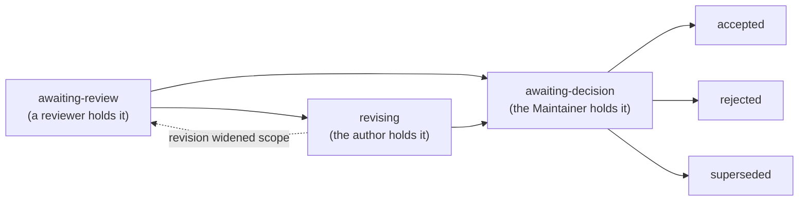
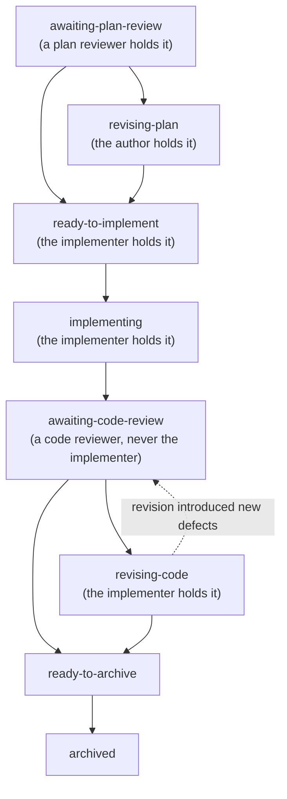

# The lifecycle

Cairn's central claim is that a change to scientific software
should leave a **durable, reviewable record of the reasoning
behind it** — not just the diff. The lifecycle is the mechanism:
every substantive change moves through a sequence of states, each
state transition is its own commit, and the deliberation is
append-only, so the record cannot be quietly rewritten after the
fact.

A change is triaged into one of **three lanes** before any artifact
opens — trivial (just commit), standard (a change note), or
deliberate (today's two-stage) — by the closed procedure in "Three
lanes, chosen by a closed triage procedure" below. The deliberate lane
carries two artifacts: a **proposal** (the deliberation — what to do,
and why) and, for non-trivial work, a **plan** (the execution — how it
was carried out, and that it was verified). They have separate
lifecycles; the standard lane's change note reuses the plan's
lifecycle below without a parent proposal.

## Why a recorded lifecycle

A scientific result is trusted because its derivation is open to
inspection. Scientific *software* deserves the same discipline: a
reviewer, a future maintainer, or a future agent should be able to
ask "why is it this way?" and find an answer that was not
reconstructed from memory. Three properties make the record
trustworthy:

* **Append-only.** A proposal is never edited to change what it
  said; a revising section is appended. The record preserves what
  was believed *at each point*, not a tidied final state.
* **One commit per transition.** Open, review, response, and
  decision each land as their own commit. Bundling hides who
  changed what, and when.
* **Commit-mediated.** The record lives in version control beside
  the code. It survives context loss and contributor handoff, and
  it is timestamped by the same history as the change it explains.

## Three lanes, chosen by a closed triage procedure

Not every change carries the same weight, and routing all of them
through one container was expensive for what most of them are. A
change is triaged into exactly one of three lanes, evaluated **in
order** — the first match assigns the lane:

1. **Deliberate** if the change (a) touches a high-risk surface
   `AGENTS.md` names, (b) breaks or widens a contract, (c) is release
   or security ceremony, or (d) is a **major new feature** — a new
   user-facing capability, module, or subsystem, because *what to
   build* is a structure question, not an implementation one. One
   carve-out crosses this rule: a **defect repair** — all three of
   (i) a failing-test reproduction, (ii) restores documented or
   intended behavior with no contract change, (iii) the touched
   surface's own test family runs in the loop — takes the trivial
   lane even on a named surface. An edit that changes what a ceremony
   or surface *does* is not a defect repair and stays deliberate,
   whether or not a public contract moved.
2. **Trivial — just commit** for defect repairs meeting the
   carve-out and the existing just-commit class (a typo, a one-line
   bug fix, an obvious correction): code + test + one code review, no
   proposal.
3. **Standard — the change note** for everything else: a change
   whose shape is already settled but that is not itself trivial. One
   artifact replaces proposal *and* plan — a file opening with *Why /
   What / Approach / Verification / Risk*, target ≤150 lines —
   reusing the plan status vocabulary below without a parent
   proposal. Its header fields, transitions, and warnings are the
   standard-note contract carried in the plan template.

The **deliberate** lane is today's two-stage proposal-then-plan
machinery below, unchanged: review obligations stay as declared and a
declared tier is not a reviewer's lever (`dual-review.md`). A tier names
the reviewer's **stance**, never their agent type, so every lane's
obligations are satisfiable by every adopter. Election upward to the deliberate lane is open to the author or
the Maintainer for anything else genuinely architectural.
**Uncertainty resolves upward**, and only the Maintainer may override
the procedure's result, on the record.

### Write once, restate never — the standard lane's contrast

The deliberate lane's proposal carries a bright-line rule: every
Response appends **one complete current-contract revision**, never a
delta (see `proposals.md` > "Append one complete current contract with
the Response, every time"). That rule exists because a proposal can
run to hundreds of lines across several rounds, and a delta-only
record forces the next reader to reassemble the contract out of the
whole history.

The standard lane does not carry that cost, because it does not have
that problem. A change note is short by construction (target ≤150
lines), so `git log` already preserves every prior state at zero
authoring cost, and the silent-section-loss failure that restatement
guards against cannot hide in two pages. Its operative sections (Why /
What / Approach / Verification / Risk) are **revised in place** while
the note is in design; reviews, responses, and decisions **append**
and are never edited, exactly as the deliberate lane's review record
already does. **Write once, restate never** names the difference
precisely: the note is written once and edited in place until review
closes it, not rewritten in full at every round. The deliberate lane
keeps full append-only, including the mandatory restatement, as
today.

## The lifecycle as a Registered Report

Scientific publishing has a format for exactly this discipline —
the **Registered Report**, in which a study's design and analysis
plan are peer-reviewed and accepted *before* any data is collected
(Stage 1), and the results are later reviewed against that
pre-registered plan (Stage 2).

Cairn's lifecycle is the same shape. The **proposal** pre-registers
a change's design and its evidence / verification plan, and is
reviewed *before* any code is written — Stage 1. The **plan** and
its code review then check the implementation, and the evidence it
produced, against that locked plan — Stage 2.

What this buys is a defense against *metric p-hacking*. When the
verification plan is committed before the implementation exists,
the evidence is judged against a prior commitment — not chosen
after the fact to flatter whatever the code happened to do. An
agent (or a human) cannot quietly move the goalposts, because the
goalposts sit in an append-only commit that predates the work.

## The proposal lifecycle

A proposal is the deliberation artifact for the **deliberate lane** —
a new abstraction, a cross-cutting refactor, a contract change,
anything worth a second opinion before it is baked in, or anything
the closed triage procedure above routes there.

<!-- retired-vocabulary-ok: this paragraph names the retired flat tokens deliberately, to say where they went and why -->
**Each status names who holds it next.** That is the point of the
vocabulary: a reader — or a board — can tell from the status alone
whose move it is. **One exception, inside a plan:** its status names an
author or a reviewer, but a chunk fenced to the Maintainer (marked
`MAINTAINER-GATED` or `MAINTAINER-ONLY`), a `defer` batch, or a deviation
request hands the next move to the Maintainer while the status stays put.
The plan then carries a `**Waiting on Maintainer**: <what>` header line,
which the board lists. A proposal needs none, because `awaiting-decision`
already names the Maintainer. The earlier flat tokens (`proposed`, `reviewed`,
`revised`) named a *phase* and left the owner to be inferred, which
is why they were retired. They stay readable on archived artifacts
and in longitudinal metrics, and are refused on an active one.

* **awaiting-review** — held by a reviewer. The author has either
  just opened the proposal — the context, the change, the
  alternatives considered, an evidence / verification plan, and the
  signals that would show the change is wrong — or has just answered
  a review. Either way the next move is someone else's.
* **revising** — held by the author. A *blocking* review moved it
  here (see `dual-review.md`); the author owes a Response **and** one
  complete current-contract revision, which together carry it to
  `awaiting-decision`. It returns to `awaiting-review` only when the
  revision widened scope — added material the review never saw — and
  only that material gets the round.
* **awaiting-decision** — held by the Human Maintainer. The author's
  revision moved it here; no further authorship is owed, only the
  Decision.
* **accepted / rejected / superseded** — the Human Maintainer
  appends the Decision. Acceptance is a *decision*, not an
  instruction to a particular contributor; implementation follows
  as separate, tracked work. **The Decision commit does not archive
  an *accepted* proposal**: it stays in `dev/proposals/` and moves
  to `archive/` later — at the plan-open commit (non-trivial work;
  see "The plan lifecycle" below) or the trivial-implementing commit
  (see "Trivial vs. non-trivial"). Only a *rejected* or *superseded*
  proposal archives in the Decision commit itself.

A proposal file is **append-only**: never edit a prior section —
append a revising one. An accepted proposal is changed only by a
new proposal that amends or supersedes it; that keeps the
amendment itself open to review, which is the whole point of the
system.

**Claim-marker maintenance is not authoring a review.** One bounded
exception to append-only: inserting a `claim_check` marker line (a
`Proposed paths:` / `Untracked paths:` / `External-repo paths:` line)
adjacent to a path token — to clear a forward-reference or sibling-repo
path flag the checker raises — is **mechanical maintenance, not authoring
or editing the review**: attribution and substance are untouched. It is
permitted even inside an append-only proposal/plan section, including
another agent's Review/Response/Decision section, bounded by four
properties:

* **additive-only** — insert a marker line; never modify existing tokens,
  prose, or attribution;
* **mechanical** — solely to clear a `claim_check` path / line-citation
  flag (re-wording a finding remains forbidden);
* **auditable + unbundled** — its own labeled `claim-marker maintenance:`
  commit (additions only), so the diff carries its own proof;
* **typo guard** — before marking, confirm the flagged path is not a typo
  of a real local path; if it is, fix it (in your own draft) or surface it
  (in another agent's section — you may not edit their content), never
  silence it.

In plans, an ordinary task-checkbox / status update is mutable workflow,
not this carve-out; the carve-out governs only the append-only
review-finding sections.

### Trivial vs. non-trivial

Not every change needs the full apparatus. A **trivial** change —
a single commit, a single area, no deferred follow-ups — is
implemented and has its proposal archived in one commit. A
**non-trivial** change — landing across multiple commits, touching
multiple areas, carrying multi-stage sequencing, or leaving
deferred follow-ups — opens a plan.

## The plan lifecycle

A plan is the execution artifact for a non-trivial accepted
proposal. Where the proposal records *what and why*, the plan
records *how the work was carried out, and that it was verified*.

The plan-open commit creates the plan and archives the source
proposal: the deliberation is closed and carried into an actionable
execution artifact. As on the proposal side, each status names its
holder.

* **awaiting-plan-review** — held by a plan reviewer. The plan exists
  but implementation has not started; it waits for its plan-review
  section (see the plan-review precondition below).
* **revising-plan** — held by the author, who folds plan-review
  findings into the plan's operative cells; the fold carries it to
  `ready-to-implement`. Plan review has one round, never a second.
* **ready-to-implement** — held by the implementer: the review gate is
  satisfied and work may begin. A plan marked `Plan review: not
  required` may **open** directly here, or at `implementing` when the
  opening commit already carries the implementation evidence. That
  fast path is offered only at opening, never out of
  `awaiting-plan-review`, where a `required(...)` review is
  outstanding by definition.
* **implementing** — held by the implementer; implementation commits
  land.
* **awaiting-code-review** — held by a code reviewer, who is never the
  implementing agent.
* **revising-code** — held by the implementer, answering code-review
  findings; the answer carries it to `ready-to-archive`, and back to
  `awaiting-code-review` only when the revision introduced new defects.
* **ready-to-archive** — held by whoever closes the loop: review has
  passed and the archive commit is owed.
* **archived** — lasting truth has migrated to durable homes (topic
  docs, the changelog, the roadmap) and the plan is archived.

Unlike a proposal, a plan is an execution artifact: status,
progress markers, and commit hashes are updated in place as work
proceeds. But review findings and archive decisions are
**append-only**, mirroring the proposal's contract.

### The plan-archive precondition

**A plan never archives until a code review has occurred.** This
is the bright line that makes review work end-to-end on the
implementation side, parallel to the proposal review that makes it
work on the deliberation side. Without it, a fast implementation
closes its own loop before any independent eye sees the code. The
plan-archive commit is therefore always **distinct** from the
implementing commits — it is the artifact of "review happened, and
the loop is closed."

### The plan-review precondition

Symmetric to the plan-archive precondition, at the *entry* boundary:
**a review-required plan does not start implementation until its
plan-review section has landed.** The plan-archive gate guards
*review-before-close*; this gate guards *review-before-implement*. Both
are needed for the review system to work end-to-end — without the entry
gate, an agent slides from plan-open straight into implementation and the
warranted review never happens.

The gate is **explicit, not remembered**: every plan (and its source
proposal) carries a mandatory **`Plan review: required(<obligation>) | not
required(<rationale>)`** line. The author states it; the Maintainer
ratifies; there is **no silent default** either way. When `required`, the
plan opens in **`awaiting-plan-review`** and its plan-open and
first-implementation commits stay **distinct** (so implementation cannot
front-run the review); it reaches `ready-to-implement` only once the
review section lands. When `not required`, the rationale is on the record and the
plan may combine plan-open with first implementation (fast multi-stage).

The plan review follows the one-stance framing in `dual-review.md`, and it
is **always a fresh-context, one-round pass**: a read from a different agent
type is never a requirement or an escalation target. A plan whose surface
calls for security treatment declares the obligation as `required(Internal +
Internal Security Review)`, cleared only by an appended `## Plan review` pass
whose `**Obligation**` line matches it, never by an ordinary pass and never
by a record merely titled `## Security review (...)`; see `dual-review.md` >
"Plan review is Internal, always".

### Fast multi-stage

When the implementation itself fits in one commit but the work
still touches multiple areas or carries follow-ups, the plan-open
and first-implementation commits may **combine** — but only for a plan
marked `Plan review: not required` (a review-required plan keeps them
distinct, per the plan-review precondition above). The plan-archive
commit still stands alone, after review. The lifecycle compresses;
it does not collapse.

## Loop-fidelity verification

The fold-back loop's **capture** and **decide** halves are rigorous: a
discovery becomes a ledger row, a row becomes a proposal, a proposal is
reviewed and decided. Its **verification** half — *did the decided change land
**and work**, faithfully, all the way to adoption?* — is the property this
section names. An upstreamed change is not **closed** until it is verified
faithful at all three checkpoints of the loop:

1. **Decision → implementation (#52) — the fidelity sign-off.** At plan-archive,
   the migration note confirms the **landed implementation commit matches the
   accepted Revised section**, and **names which Revised section governs**.
   Append-only deliberation keeps superseded designs beside the chosen one, so
   "which section governs" is a real ambiguity (a reader once mistook an
   abandoned design for the accepted one); naming it removes the ambiguity. The
   sign-off rides the coverage-line discipline — it is *falsifiable* (cite the
   commit + the section), not a bare "matches." It fails *open* if an
   implementer skips it, so a missing sign-off line is a code-review finding,
   like an unfilled slot.
2. **Implementation → adoption (#58) — the dangling-reference gate.** The
   `check_cairn` self-check **fails closed** when an adopter-facing `templates/`
   surface references a Cairn-internal-only path (`doctrine/*`) that is neither
   transplanted into the install set nor marked a deliberate citation — a
   reference that resolves in the Cairn source but **dangles once installed**.
   When run: `python scripts/check_cairn.py` — at review time, and in the
   **maintainer-run** release checklist (`bootstrap/security_check.py` invokes
   it, when a maintainer runs that). This is the automatable flagship; its
   mechanics live in
   [`../bootstrap/fidelity-check.md`](../bootstrap/fidelity-check.md) >
   "The loop-fidelity gate".
3. **Adoption → canonical (#54) — drift surfacing.** A session-start / goodnight
   check **surfaces** (informational; never blocks) when an adopter's installed
   tree is behind canonical, so the per-change loop is confirmed closed
   *continuously*, not only on the periodic harvest cadence. See
   [`session-routines.md`](session-routines.md) > "Adoption drift surfacing".

The three are one **property** with three checkpoints, not three unrelated
checks — hence one home here. Their *delivery* is independent: the #58 gate is
automatable and ships on its own merit; #52 and #54 are discipline/cadence
companions that may land or evolve separately.

## Procedural-gap inline Decisions

Implementation discovers, mid-flight, that a specific procedural
step was not pre-specified by the proposal or plan — a missing
enumeration, an unanticipated sub-step, a clarification on how a
pre-specified rule applies to a specific case. The unmodified
lifecycle would route this through a new proposal cycle, which is
over-process for a procedural detail; the under-process failure is
symmetric — the implementer quietly makes the call, exceeding
delegated authority and diluting the Decision-of-record principle.

The Maintainer may close such a gap via a **procedural-gap inline
Decision** — a brief Decision section appended to the live
proposal or plan, recording the call and its reasoning — **only
when all three of these criteria hold**:

1. **Bounded mechanical gap.** The gap is a specific procedural
   detail, not a substantive scope hole or a competing-trade-off
   that requires deliberation.
2. **Resolution preserves substantive scope.** The inline Decision
   does not re-open the proposal's substance; it answers a "how"
   question, not a "whether" question. Read alongside the
   original Decision it *fills in*, not *amends*.
3. **Closure preserves the implementing agent's executable
   surface.** After the Decision lands, the implementer can
   continue executing — the gap is closed in the sense that the
   next step is now defined. The Decision does not introduce
   new prerequisites that themselves require deliberation.

The three criteria are co-load-bearing. Without (1) an inline
Decision could absorb substantive scope under the cover of
"procedural" and bypass review. Without (2) it could quietly
change the original Decision's substance, leaving the
append-only record misleading. Without (3) it could *introduce*
scope rather than close it, layering new prerequisites on top
of the gap. If a gap fails any criterion, the right response is
not an inline Decision but a fresh proposal that amends or
supersedes.

Inline Decisions are short — a paragraph naming the gap, the
call, and the reasoning — attached to the live artifact at the
natural place (a "Decision clarification" subsection, dated,
attributed to the Maintainer). They are not separate proposal
files; they are append-only additions to the executing
artifact. The pattern is the structural alternative to
deliberation-by-conversation: it converts what would otherwise be
a chat resolution into a durable Decision-of-record on the
artifact.

## Chat preferences are not a lifecycle Decision

Maintainer chat-mode preferences during a working session ("maybe X",
"I lean toward Y", "what if we tried Z") are **input** — useful for
shaping a proposal's draft — not **Decisions** on proposal-worthy
changes. A lifecycle Decision attaches to a *written* proposal another
agent has reviewed (see "The proposal lifecycle"). When an agent
receives chat preferences on a proposal-worthy change, the right move
is to fold them into a proposal draft — cited as **"maintainer
preference during drafting"** in *Rationale* or *Alternatives
considered*, not as the Decision — open it for review, and *then* wait
for the Maintainer's Decision.

**Bounded mechanical directives** are different: "revert this commit",
"fix this typo", "scribe the Decision on proposal X" proceed under the
triage escape hatches (`proposals/_template.md` > "Triage"). When an
agent scribes a Decision at the Maintainer's instruction, it is bound by
the **Decision-commit scribing guard-rail** (`AGENTS.md` > "Git and
commit workflow"): the authorization is quoted verbatim, the instruction
must be unambiguous or confirmed, and the commit carries the Decision
only. What chat *cannot* do silently is convert an unreviewed,
proposal-worthy design choice into an accepted outcome. **When it is
unclear whether a directive authorizes action without a proposal, the
triage rule is the arbiter.**

Citing chat input keeps the source auditable without pretending chat
was the Decision: an accepted proposal's Decision section names *what
was decided*; the body's chat-input citations name *what shaped the
draft*. This is the input-side complement to the procedural-gap inline
Decision above — that rule says what the Maintainer *can* close on a
live artifact; this one says what chat *cannot* silently become.

## Surfacing judgment calls to the Maintainer

Much work divides into a large mechanical part and a smaller set of
**judgment calls** that need the Maintainer's direction — the ~20%
where acting silently is wrong because the choice turns on priorities,
history, or trade-offs the agent cannot see. Surface those as a
structured kickoff, not as silent decisions buried in the work:

* **Finish the mechanical part first, queue the judgment calls.**
  Complete the clearly-mechanical ~80%, accumulating the queue as you
  go; then stop and surface it in a single message before committing.
  Don't bundle judgment calls into mid-work commits.
* **Lead with what changes for the user, not the architecture.** If
  the Maintainer is reasoning about outcomes and real workflows, answer
  in those terms; the architectural framing follows as supporting
  structure, not the lead.
* **Give 3 options + a recommended pick + plain-English rationale.**
  The Maintainer's time is the bottleneck; pre-digesting the decision
  space with a *defensible recommendation* (not "it depends") is the
  agent's contribution. If you genuinely cannot choose without their
  input, say so rather than hedging.
* **Name what each option changes on disk** — in the roadmap board,
  the docs, the code. Concrete diffs ("this entry collapses to one
  line", "this gate is deleted") beat abstract framings ("we'd tighten
  the contract").
* **Wait for direction, then fold the dispositions into one commit**
  with the related work — not a separate "mechanical" and
  "judgment-call" commit.

The Maintainer brings framing the agent lacks (priorities, project
history, what users do); the agent brings structural surfacing the
Maintainer has not inspected (cross-references, doctrine implications,
downstream effects). Surfacing well is the agent's half of that
exchange.

## Deferred-follow-up revival

An accepted proposal may carry an **explicitly deferred**
item — a sub-question or sub-scope deferred to a later proposal.
When the time comes to revive that deferred follow-up, **the
revival is itself proposal-worthy** under the standard trigger
conditions: substantive scope, public-contract changes,
cross-cutting refactor, new abstractions, scientific assumptions.

A deferred follow-up does not become implementable just because
it is revisited. The proposal that originally deferred it named
the deferral as a recognition that the substance had not yet
been deliberated, not as an authorization to implement it later
without further review. Reviving the item re-enters the
proposal lifecycle from `awaiting-review`.

This rule prevents the pattern where a deferred follow-up
accumulates implementation detail in side conversations between
the original Decision and its eventual revival, then lands
without ever returning to the deliberation surface. The
append-only record's value depends on every substantive change
having a recorded review; the revival rule is what keeps that
guarantee intact across the time gap a deferral introduces.

## The roadmap is a current-state index, not a historical log

The roadmap surface is **a current-state index**, not a record
of completed work. Open and in-flight items live there; items
that complete migrate **out** of the roadmap and into the
durable record — the archived proposals and plans, the
implementing commits, the changelog. Completed entries are
*removed*, not crossed off or struck through.

The failure mode this addresses: a roadmap that accumulates
"completed" entries gradually becomes the primary
where-did-this-happen surface, when in fact the archived
artifacts are where the truth lives. The roadmap's completed
entries are short, lossy, and out of date by definition; the
archived artifacts are full, durable, and dated to the
implementing commit. A reader who treats the roadmap as a
historical log reads from the worse surface.

The no-history posture forces the durable record to *be* the
durable record, rather than being shadowed by an incomplete
summary. It also keeps the roadmap usable: a roadmap that holds
only what is open or in flight reads quickly and answers
"what's live?" cleanly.

## Archive precondition — every deferred follow-up carries a disposition

The plan-archive precondition above guards *that review happened*.
A second precondition guards *that nothing was silently dropped*:
before a proposal **or** a plan archives, every explicitly-deferred
follow-up it carries must carry a **recorded disposition**. The
archived artifact is closed; a follow-up that lived only inside it
would vanish from the live surfaces the moment it moved to
`archive/`.

**A disposition is not the same thing as a durable home.** The
precondition exists so nothing is dropped *silently* — not so
everything is kept *forever*. An artifact that declines a follow-up
in writing, with a reason, has dropped nothing silently. Requiring a
durable home for every deferral instead makes the roadmap the only
sanctioned outcome, which turns it into a one-way accumulator: review
promotes observations to findings, the scope fence defers what the
artifact cannot fix, and this precondition obliges the board to keep
all of it. There is no discarding step anywhere in that chain unless
this rule provides one.

**An archived artifact is a record, not a to-do list.** Nothing still to be
done may have an archived artifact as its **only home**. A live home is one of:

* an open proposal or plan that names the item in its own text;
* an issue, cited by number;
* a board row.

A pointer to an archived artifact, or to a plan that has not been opened yet,
is not a live home: the first is closed and no one reads it, and the second
does not exist. Work handed to such a plan is a `defer`
(`plans.md` > "Accepted scope is a floor").

### The disposition vocabulary

Use the disposition grammar already defined in `proposals.md` >
"Response — disposition grammars", **minus `reject`, plus `guard`**.
The subtraction is deliberate: `reject` answers a *review finding*
("this critique is wrong"), and a follow-up that survived to
archive-time is not rejected — it is `wontfix` **with a rationale**,
which is the same act with the reason on the record. The archive-time
vocabulary is therefore:

* `accept` — fixed in this artifact's scope. Includes writing the
  doc the finding asked for, and narrowing the artifact's own claim
  so the finding no longer applies (a scope-cut). **A scope-cut is
  claim correction with no work removed.** Removing previously
  proposed or accepted work is a *scope reduction*, which is not an
  `accept`: it takes the outcome test and the scope-remainder record
  below, and only the Maintainer may concede it.
* **`guard`** — homed in an artifact that **executes**: a test node,
  an assertion, a runtime guard. The entry **names the node**
  (`path::node`). A follow-up whose revival condition is mechanical
  ("any edit to `parse_config()`") belongs where that condition
  fires, not on a roadmap that fires only when a human re-reads it.
  **A comment is not an eligible `guard` artifact** — comments do not
  fire, and a comment is a roadmap row relocated into a file fewer
  people read.
* `wontfix` — explicit non-action, **with a rationale**. Subject to
  the eligibility rule below.
* `defer` — deposited on the roadmap board, or appended to the open plan
  that takes it. **Requires the
  Maintainer's authorization, quoted verbatim** (the attestation form
  is the one used for scribing a Decision). A deposit on a shared
  board is a scope decision, and scope is Maintainer-held.
* `defer` (successor) — opened as its own proposal, for a genuine
  discovered blocker whose in-scope fix would be the bundling this
  lifecycle already forbids. Also the Maintainer's call.

**There is no required order.** What is required is that the record
say why the chosen disposition is the right one. An ordering rule
would make the cheapest disposition the default, which is the failure
being fixed rather than a fix for it.

**A `defer` says why it could not be fixed now.** The record already gives a
reason for each disposition; for a deferral it must be one of three:

* It **needs a Maintainer decision**: name that decision.
* It **belongs to work already in motion**: name the receiving open plan or
  proposal and append the item to its text; the Maintainer's quoted
  authorization covers the addition to that scope. Do not create a duplicate
  issue or leave only a pointer to work that has not opened.
* It is **over the cost bar**: name the person-step or the size that prevents
  fixing it now. For a finding on the plan's own change, about a chunk's worth
  (one commit with its test when there is no plan) is the size bar.

"Non-blocking", "nit", "low priority" and a reviewer's suggested home are not
reasons. The operational cost bar is in `AGENTS.md` > "Fixing an easy problem
you meet": prescribed test runtime is machine time, not a reason by itself.
An item that is cheap, needs no decision and belongs to no work in motion is
fixed before archive. This orders nothing among `accept`, `guard` and
`wontfix`: consequence decides what may not be declined; cost decides what
must be fixed. A true cheap defect is fixed unless fixing it needs a decision.

### Two eligibility rules

* A follow-up that **reaches an adopter, blocks a release, or needs a
  Decision** is **ineligible for `wontfix`**. Consequence, not
  convenience, decides what may be declined.
* A follow-up **named by a closed artifact's disposition block** is
  ineligible for `wontfix` without the Maintainer, and any re-routing
  of it is recorded as a forwarding entry. An archived record is
  append-only: when the migration it asserts stops being true, it
  cannot be corrected in place.

**On a solo profile** — where the author and the Maintainer are the
same person — the `defer` gate collapses to a written justification
to oneself. That is **weaker, but not vacuous**: the value is that
the justification is written into the record at a serialization
point, where a later reader (or the same person, cold) can see what
was claimed. That is the same premise the rest of this lifecycle
rests on.

### The scope-remainder record

A **scope-remainder record** is what a reduction leaves behind: work that
was in the artifact's baseline scope and is no longer being delivered.
It is created at the moment of removal, not at archive time, and it is
**one grouped record per source artifact** rather than one row per unit.
The rule that produces it — and the outcome test that decides whether a
narrowing produced one at all — is in `dual-review.md` > "Review
expectations — the scope-reduction trap".

Its effect on this precondition: **each entry blocks archive** exactly
as a deferred follow-up does, and closes the same way — `accept`,
`guard`, `wontfix` bounded by the two eligibility rules above, or
`defer` with the Maintainer's quoted authorization.

Two things it is *not*:

* **Not a set of roadmap rows.** Dispersing a reduction into individual
  board items preserves the words and loses the reach, on a board that
  is already a one-way accumulator. If a board deposit is the chosen
  disposition, the grouped parent survives; it does not shed one row per
  removed unit.
* **Not owed for a declined suggestion.** A stronger outcome proposed
  only during review was never in the baseline, so declining it creates
  no remainder and nothing to dispose of.

### Recording it

The record must be **auditable**. Record each follow-up's disposition
in a durable location the team's workflow already preserves — the
archive commit body, the pull-request description, or the artifact's
closing metadata — as an explicit **`Dispositions: …`** block. The
older `Follow-ups migrated to: …` spelling remains valid and is still
recognized; artifacts already archived under it are correct as they
stand and are never rewritten. The *where* is adopter-local (a
squash-merge team may keep the audit in the PR description rather
than a commit body); the requirement is that a cold reader can
reconstruct, from the durable record alone, what happened to every
deferral.

**Archive-preparation is the serialization point** — for plans and
proposals alike. `defer` requests are presented as **one batch**
there, never one at a time; that batching is what keeps the
Maintainer gate affordable. A plan review may take an early pass at
follow-ups already visible then, and a proposal that archives inside
its plan-open commit presents its block at that commit's preparation.

**This precondition is documentary, not mechanical.** Nothing checks
that a disposition is the *right* one, and nothing checks that the
`defer` authorization was really given — the enforcer is a reviewer
opening the artifact at archive-preparation. A checker could confirm
a block exists and every item names a token; it could not distinguish
a considered decline from a template-shaped one, and a gate that
passes the degenerate case is worse than no gate because it is
silent.

## Removal preconditions for a roadmap item

"The roadmap is a current-state index" (above) says a completed item
is *removed*, not crossed off. **Removal has preconditions.** Before
an item is deleted from the roadmap it must clear three gates:

1. **The accepted proposal / plan is archived** — its deliberation
   and execution records are in `archive/`.
2. **Lasting truth has migrated** to durable homes — doctrine, topic
   docs, the changelog — per the archive precondition above.
3. **Cold-start answerability** — "what was tried here, and why?" is
   answerable from the archives plus the commit log *without* the
   roadmap entry.

If any gate is unmet, finish that migration first, then delete.
Cairn states that completed items "migrate out"; these gates are
what make the migration safe rather than lossy. They are the
roadmap-side complement to the archive precondition: one guards the
artifact leaving the board, the other guards the board entry
leaving the roadmap.

## Adaptation

The lifecycle is part of the **invariant kernel** — no adaptation
dimension removes it. What scales with the team is the *review*
applied within it (see `dual-review.md` and `dimensions/`): a
solo, single-agent team runs the lifecycle with a lighter review
tier; it still runs the lifecycle. The forkable proposal and plan
templates live in `templates/`; this document explains what they
are for and why their contracts are shaped as they are.
