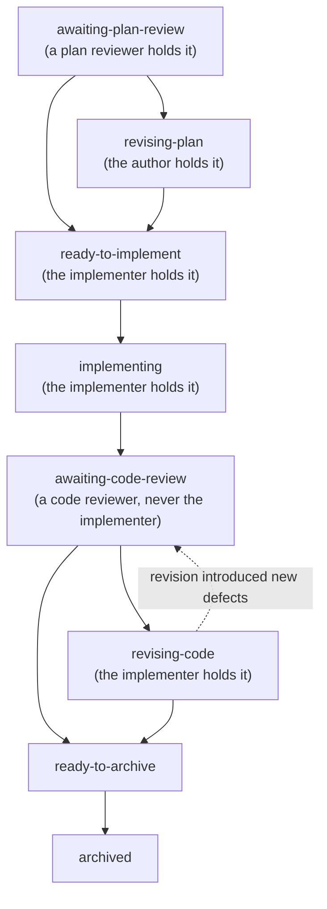

<!-- cairn-internal-ref-allow: doctrine/lifecycle.md doctrine/dual-review.md doctrine/proposals.md reason=doctrine/ citation convention -- a doctrine reference is a citation to Cairn's published methodology, not an installed local file (see templates/core/AGENTS.md, "Where doctrine/ references resolve") -->

# Plans — type-specific lifecycle doctrine

This page covers the doctrine specific to **plan artifacts**
(`dev/plans/<slug>.md`).  Shared lifecycle concepts — the Registered
Report analogy, why the record exists, the claim-marker maintenance
exception, deferred-follow-up revival, roadmap management, and
archive preconditions — live in `doctrine/lifecycle.md`.
Review-tier and structural-independence doctrine lives in
`doctrine/dual-review.md`.  Proposal-lifecycle doctrine (triage,
file moves, Response grammars) lives in `doctrine/proposals.md`.

**The standard lane's change note also lives at `dev/plans/<slug>.md`**,
reusing the status vocabulary and much of the machinery below without a
parent proposal — see `doctrine/lifecycle.md` > "Three lanes, chosen by
a closed triage procedure" for the triage that routes there, and the
plan template for the note's own header fields, transitions, and
warnings. This page's plan-review and code-review doctrine below
applies to the deliberate lane's plan; the standard lane's own review
and warning behavior is the note's own contract, not restated here.

---

## The plan lifecycle



The plan-open commit creates the plan and archives the source
proposal. Each status names who holds it next.

* **awaiting-plan-review** — *(only for a review-required plan; see
  the plan-review precondition below)* the plan exists but
  implementation has not started, waiting for its plan-review section
  to land.
* **revising-plan** — the author folds plan-review findings into the
  plan's operative cells; the fold carries it to `ready-to-implement`.
  Plan review has one round, never a second.
* **ready-to-implement** — the review gate is satisfied and work may
  begin. A plan marked `Plan review: not required` may open directly
  here, or at `implementing` when the opening commit already carries
  the implementation evidence.
* **implementing** — implementation commits land.
* **awaiting-code-review** — a code-review pass examines the
  implementation; the reviewer is never the implementing agent.
* **revising-code** — the implementer answers code-review findings; the
  answer carries it to `ready-to-archive`, and back to
  `awaiting-code-review` only when the revision introduced new defects.
* **ready-to-archive** — review has passed and the archive commit is
  owed.
* **archived** — lasting truth has migrated to durable homes and the
  plan moves to `dev/plans/archive/`.

A plan is an *execution* artifact: its status, progress markers,
and commit hashes are updated in place. Review findings and the
archive record are append-only. *(One bounded exception to those
append-only sections: inserting a `claim_check` marker line —
`Proposed/Untracked/External-repo paths:` — adjacent to a path token is
**mechanical maintenance, not authoring a review** (additive-only, its own
labeled `claim-marker maintenance:` commit, typo-guarded). A task-checkbox
/ status update is ordinary mutable workflow, not this carve-out. See
the Mutability rule below and `doctrine/lifecycle.md` > "The proposal
lifecycle".)*

**The plan is the Stage 2 of the Registered Report.** Where the
proposal pre-registered the design and the verification plan
(Stage 1; see `doctrine/proposals.md`), the plan and its code
review check the implementation and the evidence it produced
against that locked plan. This is the defense against metric
p-hacking the proposal's Stage 1 named: judged against a prior
commitment, not chosen after the fact.

A non-trivial accepted proposal typically spans **5-10 commits**
across the full lifecycle (`accepted` Decision, plan-open,
implementation commits, code-review, sharpening, plan-archive); the
**minimum is 4** (plan-open + first implementation combine, and code
review records inline with the sharpening commit). Trivial accepts
collapse implementation + proposal-archive into a single commit —
they have no plan, so the plan preconditions do not apply.

### Release-gated plans (an expected parked state)

A plan may be explicitly **release-gated** — a phase that cannot fire
until a release boundary has elapsed (e.g. a removal step that waits
on a deprecation clock). Such a plan may remain `implementing` in
`dev/plans/` **indefinitely**, parked between its pre-release and
post-release phases. This is the plan's *designed* lifecycle state —
not clutter, not a hygiene problem; do not "clear" it.

---

## The plan-archive precondition

**A plan never archives until a code review has occurred.** This is
the bright-line rule that makes the review system work end-to-end on
the implementation side — parallel to the proposal-review pass that
makes it work on the deliberation side. Without this rule, fast
implementations escape independent review because the archive commit
closes the loop before any independent eye sees the code.

Concretely, an accepted non-trivial proposal flows through:

```
plan-open (+ optional first implementation)   <- can be ONE commit
implementation (one or more commits)
code-review pass (findings appended in plan; sharpening fixes if needed)
plan-archive (lasting-truth migration; this is what closes the loop)
```

The plan-open and first-implementation commits MAY combine when the
work is tractable in one commit — but only for a plan marked
`Plan review: not required` (see the plan-review precondition below).
The **plan-archive commit, however, is always distinct** from the
implementing commit(s); it is the artifact of "review happened and
the loop is closed." Bundling plan-archive into the implementing
commit hides whether code review actually occurred.

Code review's reviewer is **not the implementing agent** — that is the floor,
and a same-type agent in an independent context clears it. **External or
Security code review is an explicit escalation** for implementation risk the
proposal review did not resolve; it is not a default, and no change to the
plan-review allocation silently upgrades a code review into one. Trivial
accepts skip the plan entirely (per the triage rule below) and
therefore do not encounter this precondition.

---

## The plan-review precondition

Symmetric to the plan-archive precondition, at the *entry* boundary:
**a review-required plan does not start implementation until its
plan-review section has landed.** The plan-archive gate guards
*review-before-close*; this gate guards *review-before-implement*.

The gate is **explicit, not remembered**: the `**Plan review**` metadata
line above is mandatory — `required(<tier>)` or `not required(<rationale>)`,
with **no silent default**. The author states it; the Maintainer ratifies.
When `required`, the plan opens in **`awaiting-plan-review`** and reaches
`ready-to-implement` only after a dated `## Plan review` section lands: the review
**and**, when it raised findings, a disposition (see *The record schema*
below for the two accepted forms and their positional bound).
Its plan-open and first-implementation commits stay
**distinct** (implementation cannot front-run the review). When
`not required`, the rationale is on the record and the plan may combine
plan-open with first implementation.

```
open --> awaiting-plan-review --> executing --> review --> archived   (review required)
open ------------------------->   executing --> review --> archived   (review not required)
```

Like the plan-archive precondition, this converts a *remembered* norm
into a *structural* one: the gate is a status the plan **carries**, not
an agent's memory (the recurring plan-review-skip failure mode). The
plan header's `Plan review:` line makes the gate legible to a cold
reader; a static plan-review lint is the mechanical backstop (a
`required` plan past `awaiting-plan-review` must carry a dated review
subsection). The review *tier* is **always Internal** — see
`doctrine/dual-review.md` > "Plan review is Internal, always" for the
full statement, including the `+ Internal Security Review` obligation
a security-sensitive plan declares.

---

## Plan triage rule

**Open a plan when an accepted proposal's implementation:**

* Will land across multiple commits.
* Touches multiple files / areas (code + tests + docs).
* Has multi-stage sequencing (e.g., infrastructure first, then
  per-target rollouts).
* Carries deferred follow-ups that need a `defer` home before
  archiving.

**Skip the plan when:**

* The implementation is a single commit.
* The change is single-file or single-area.
* No follow-up needs a `defer` home (the proposal's "what's next" is
  fully captured in the implementing commit message).

When in doubt, open the plan. The cost is low (one file in
`dev/plans/`); the benefit is durable execution context for any agent
who picks up the work mid-flight.

### Fast multi-stage (a sub-pattern of non-trivial)

The triage bullets above are OR-conditions: a plan is warranted when
ANY of the four hold. The common sub-pattern where the first bullet
is FALSE (the implementation itself fits in one commit) but at least
one of the others holds (touches multiple files / areas, has
multi-stage sequencing, or carries deferred follow-ups) is called
**fast multi-stage**.

Fast multi-stage compresses the implementation phase into a single
commit but does **not** collapse the lifecycle. Plan-open + first
implementation may combine in one commit (per the plan-archive
precondition above); plan-archive remains distinct. The minimum
lifecycle is **three commits past the implementing combined commit**:

```
commit N:    plan-open + implementation       (status: review)
commit N+1:  code review + sharpening
commit N+2:  plan-archive + lasting truth
```

Ordinary multi-commit plans are not fast multi-stage, but they use
the same review-before-archive guardrail.

---

## Mutability rule

Plans are **execution artifacts**, not deliberation artifacts; they
need ordinary status tracking as work proceeds without the
bright-line append-only contract that proposals carry. Two classes
of edit:

**Mutable in place** (status updates as work proceeds):

* `Status` field (`awaiting-plan-review` / `revising-plan` /
  `ready-to-implement` / `implementing` / `awaiting-code-review` /
  `revising-code` / `ready-to-archive` / `archived`) plus
  the "last update" date.
* The `**Waiting on Maintainer**: <what>` header line, beside `Status`:
  written when a plan's next move becomes the Maintainer's (a fenced
  chunk, a `defer` batch, a deviation request), and deleted when they
  answer. A change note carries it the same way.
* Checkboxes / progress indicators in the Sequence section.
* Commit hashes filled in as commits land.
* Verification notes (test counts, runtime, tooling output).
* Link targets when referenced files move.
* **Chunk-table cell text — pre-implementation only** (any status
  before `implementing`: `awaiting-plan-review`, `revising-plan`, or
  `ready-to-implement`; and no commits in flight against the chunks
  being edited). Inline edits driven by accepted plan-review findings
  land here, with the Sharpening subsection naming which cells changed
  and why. Once status flips to `implementing`, chunk-table edits
  follow the append-only rule below.

**Append-only** (history of decisions):

* Scope changes (add a new sub-section if scope materially shifts;
  don't rewrite the original Scope paragraph).
* Material sequence changes (add a "Sequence revision" note; don't
  edit prior Sequence entries that are already in flight).
* Review findings — both `## Plan review` and `## Code review`
  sections are append-only once a reviewer has added findings;
  Sharpening subsections under either are also append-only. Mirrors
  the proposal Review section's append-only contract.
* Archive decisions (Lasting-truth migration entries are append-only
  once written).

**Distinct from discovery-driven inline revisions.** When the
implementing agent (or the plan author) revises the plan mid-flight
in response to *implementation discovery* — not in response to a
review pass — inline chunk-table edits are also permitted before
status reaches `implementing`, but no `## Plan review` section is
required. The
audit trail lives in the revision commit's message + the git diff.
Add a `## Plan review` section only when an actual review pass
occurred.

Once the plan archives to `dev/plans/archive/`, the file is
**closed** — only link maintenance permitted (parallel rule to
archived proposals).

---

## Implementation verification boundaries

A plan maps verification to three boundaries. This keeps iteration useful,
integration evidence exact, and review independent without treating repeated
execution of one broad command as a second opinion.

### Boundary A — Iteration (scoped)

Each chunk's acceptance criteria map the changed invariants and public paths to
their affected tests and standing surface gates. The implementer runs that
reviewed scope while iterating and adds a newly discovered dependency to the
plan before relying on it. A trivial change, with no proposal or plan, maps
instead to the tests that own each touched surface, found by searching for what
imports or reads the touched files rather than by expectation, plus that
surface's standing gates. There is no permanent "fast suite": speed does not
establish coverage. If a substantive surface has no such mapping, or its
effects cannot be bounded confidently, the full project suite is the
fail-closed fallback.

Work confined to ordinary prose or deliberation records runs the applicable
claim, link, snippet, schema, and neutrality gates rather than an unrelated
engine suite, on any surface, a high-risk one included. When a search finds no
test or manifest that pins the prose, its record is the gates run and that
search, in place of a bounded record. Executable snippets, generated or frozen
fixtures, gate manifests, and contracts whose plans name test coverage are not
ordinary prose.
A **substantive surface** is anything that is not ordinary prose under the
prose-only rule: code, tests, executable templates and snippets, fixtures,
manifests, and prose a test or manifest pins.

### Boundary B — Integration (one stable record)

After the final implementation commit and before code review, the implementer
runs against a clean, stable commit using the configured canonical
interpreter/runtime. The default is the **full project suite**; work whose
**mapping bounds the change's effects confidently** may instead run
that mapping plus every standing gate for every touched surface. This is the
same test and the same fail-closed direction Boundary A already uses — the full
suite is the escalation, not a ceremony paid at every boundary.

**The fence is a refusal, not a checklist.** Bounded mode refuses — and the
full suite runs — whenever the change touches a **contract surface** (the
install contract, the fidelity or gate manifest, the lockfile schema, the
published install manifest) or a **trust-ceremony surface** (any high-risk
surface the project's governing file names, or work under a release or security
ceremony, which keeps its own exhaustive commands). **Uncertainty resolves to
`full`.**

**The bounding claim is written, then adjudicated.** The record carries
`**Boundary B mode**: full | bounded`. On `bounded` it must also name the
touched surfaces, the test files or nodes and the standing gates it ran, with
counts, why the effects are bounded, and the explicit absence of any contract
or trust-ceremony surface. Boundary C then records
`**Bounding**: ACCEPTED | FULL RUN REQUIRED`.
`FULL RUN REQUIRED` **invalidates** the bounded record, which lands it on
trigger 1 ("no valid Boundary B record exists") — the six triggers stay six.

Why the claim is adjudicated rather than merely stated: the implementer chooses
the mapping, writes the argument, and captures the saving. A norm alone assumes
nobody profits from the miss. No tool gate is proposed — a check could confirm
the field is present, never that the argument is true, and a green check on the
question that needed judgement is the clean-pass trap manufactured. What closes
it is whose signature is on the verdict: an independent reviewer, who captures
nothing.

**Boundary B governs every implementation, a trivial change included.** A
trivial change's mapping is the owning tests Boundary A names, and Boundary C's
Bounding verdict reviews it afterwards. It runs before the commit, not after, on
exactly the bytes being committed: a tree clean apart from the change, or a
separate copy holding only it. Its record is its commit body, not a plan
section, and carries the mode, the interpreter, and on `bounded` every field the
bounding claim above names.

**An already-open plan keeps the verification contract written in it.** Bounded
mode becomes available to it only through that plan's own explicit, append-only
revision under the deviation rule. A plan opened after this rule landed may use
bounded mode where its reviewed mapping supports it. The reason the rule is
needed at all: editing doctrine acts immediately while editing the plan
templates acts prospectively, so an in-flight plan would otherwise receive two
answers about its own evidence obligation. The plan receives an append-only
record only after the run completes:

```markdown
## Implementation verification -- <agent> -- YYYY-MM-DD

**Tested commit**: <full revision ID>
**Reviewed range**: <base revision>..<tested endpoint>
**Interpreter/runtime**: <path and version>
**Pre-run state**: <clean tree; HEAD = tested commit>
**Post-run state**: <clean tree; HEAD = tested commit>

| Command | Exit | Outcomes | Elapsed |
|---|---:|---|---:|
| <full suite and standing integration commands> | <code> | <pass/fail/skip/xfail/xpass counts> | <time> |

**Non-pass disposition**: <explicit disposition; ordinarily none>
**Plan-specific acceptance commands**: <commands and results>
**Known omissions**: <what this evidence did not exercise>
```

Do not place an empty Implementation verification heading in a newly opened
plan: an empty section looks like landed evidence. The record is committed in a
later plan-only commit, so live `HEAD` may advance without changing the tested
implementation bytes.

A plan's record is valid only when the tested commit contains the entire
reviewed range, pre/post `HEAD` both equal the full tested revision, and the
tree is clean before and after. A later review or record-only commit does not
invalidate it.
A later unrelated implementation commit neither falsifies what the record says
about its named tree nor gains coverage from it. Any later commit included in
the review that changes implementation, tests, executable templates, or
fixtures in the reviewed range requires a replacement Boundary B record.

This is a human-readable process attestation under a trusted-contributor model,
not a signed receipt or parser-enforced claim. It does not authenticate the
author or prove the commands ran. Release verification is a separate ceremony:
an implementation record never satisfies or shortens a release gate.

### Boundary C — Falsification (independent, reusing B)

Code review may reuse a valid Boundary B broad result only after checking the
tested revision, reviewed range, path validity, clean-state assertions, command
results, and non-pass disposition. The reviewer then chooses independent
targeted falsification under `doctrine/dual-review.md`; repeating the broad
author command by default is not structural independence.

A fresh full-suite run replaces reuse when any of these six conditions holds:

1. no valid Boundary B record exists;
2. review discovers an unrecorded cross-surface dependency;
3. a skip, xfail, or xpass lacks an adequate disposition;
4. review sharpening changes implementation, tests, executable templates, or
   fixtures in the reviewed range;
5. the accepted plan governs a trust ceremony that explicitly requires
   independent full execution; or
6. the reviewer has a concrete reason to distrust or falsify the broad result.

---

## The planning handshake

Before heavy implementation, the team converges on a short set of
questions — a lightweight handshake for plan-shaped work below the
full-proposal bar (a proposal answers these at greater depth; a plan
draining an accepted proposal inherits most of them):

* What workflow or capability are we improving?
* What is the current pain or risk?
* What contract or module boundary is involved?
* What would success look like?
* What tests, docs, or examples prove the change?
* **What must explicitly *not* change in this pass** — the scope fence?

The `## Scope` section in the plan template is where these land: it
names what the plan executes *and* what it deliberately leaves alone.
The scope fence is the load-bearing one — an unstated "not this pass"
is how a bounded plan quietly grows.

### Accepted scope is a floor — the scope fence is not a licence to shrink

The fence bounds *this pass*. It does not bound the **accepted
proposal**, and the difference is the whole of this rule.

Before a Decision, reducing a proposal is a design change the Maintainer
can see and accept or reject. **After** an accepted Decision the
proposal's scope is the authority the plan drains. A plan that carries
only A from an accepted A+B+C proposal has not chosen a tidy scope
fence — it has **deviated from approved scope**, and `AGENTS.md`
already gates deviation.

So, post-Decision:

* **The baseline is the scope as accepted.** Judge any narrowing by the
  outcome test (`dual-review.md` > "Review expectations — the
  scope-reduction trap"): `preserved` owes nothing; `degraded` or `lost`
  takes the declaration, the grouped scope-remainder record, and the
  Maintainer's explicit disposition under the deviation gate.
* **Sequencing is free; removal is not.** Moving work between chunks,
  re-ordering them, or splitting one across commits changes no outcome
  and owes no declaration. Dropping an accepted outcome does.
* **A plan reviewer cannot create that authority by calling the
  remainder "out of scope."** A reviewer may recommend a reduction and
  must state what is lost; only the Maintainer may concede it.

A **plan-review Sharpening** is where this most often bites, because a
narrowing recommendation and its acceptance land in the same section.
The Sharpening carries the `Scope delta` when the disposition it records
degrades or loses an accepted outcome.

This adds no new approval step. The deviation gate is the existing
authority point; doctrine only has to say that removing accepted scope is
one of the deviations it governs, alongside new scope, a revived struck
chunk, a contract the review never saw, and an acceptance criterion the
implementer cannot meet.

---

## Forward-reference paths — `Proposed paths:` marker doctrine

A plan typically cites paths it *plans to create* during chunk
execution (new modules, new test files, new docs). At plan-open time
those paths do not resolve, so `claim_check` hard-flags them. The
escape hatch is `claim_check`'s marker-line mechanism: a line that
begins with `Proposed paths:` (case-insensitive; optional list-item
prefix) exempts the backticked path tokens **on that same line** from
the hard path check.

Use the marker when:

* The plan opens with paths it plans to create at chunk commits.
* The plan cites future test files, fixture files, or documentation
  files in chunk tables.
* The plan moves a file — the future archive path is forward-reference
  until the move happens.

Marker shape (preferred): one or more `Proposed paths:` lines near the
top of the plan (after `## Plan triage rule`, before `## Scope`), each
listing a batch of related tokens. Multiple tokens per line are fine;
a marker line also exempts any **contiguous structured block
immediately beneath it** (table rows, list rows, or bare backticked
path-list rows) until the next blank line, heading, or ordinary prose
line.

Example:

```
Proposed paths: `path/to/new_tool.py`, `path/to/new_dir/`,
`path/to/new_doc.md`.

Proposed paths: `path/to/tests/test_new_thing.py`,
`path/to/tests/test_new_contract.py`.
```

**The marker is line- and block-scoped**: it does NOT exempt a path
where the same token recurs in ordinary prose (a chunk description, an
acceptance-criterion sentence). Such an occurrence still hard-flags.
Two clean ways to handle it, in preference order:

* **Cite the existing parent directory + the bare new filename.**
  `claim_check` treats a backticked token as a repo-path claim only
  when its first segment is a real top-level directory; a bare
  filename (no `/`) is not a claim. Write a new file as a bare name
  beside its directory — e.g. `new_tool.py` next to the existing
  `path/to/dir/` — so the directory token resolves, the bare name is
  ignored, and the full slashed path stays declared once in the
  marker. No flag, no residue.
* **Conscious-accept**, documented in the plan-open commit body — the
  fallback when the full slashed path must appear in prose; it clears
  at the implementing chunk commit where the path is created.

**Two other marker keywords** parallel `Proposed paths:`:

* `Untracked paths:` — for git-ignored paths a fresh checkout will not
  carry.
* `External-repo paths:` — for paths that resolve in a sibling
  repository this project depends on, or an upstream framework
  checkout, rather than in this tree.

All three markers exempt only the tokens on the marker line itself.
See `claim_check`'s module docstring (the "Marker lines" subsection)
for the full mechanism documentation.

**Applies to a plan's append-only finding sections too.** Under the
`AGENTS.md` claim-marker-maintenance exception, inserting a marker line
to clear a forward-reference / sibling-repo path flag is permitted even
inside an append-only `## Plan review` / `## Code review` section (and a
reviewer's findings) — additive marker line only, in its own
`claim-marker maintenance:` commit, with no change to the finding's
text. A plan's **task checkboxes / status** are ordinary mutable
workflow, distinct from these append-only finding sections. Before
marking, confirm the flagged path is not a typo of a real local path.
**Placement safety**: an inline marker is *block-scoped* (it exempts
contiguous rows beneath it until a blank line / heading) — place it
immediately adjacent to the target token and leave a blank line after
the target row so it does not over-exempt later rows; for many
sibling-repo paths, prefer the file-level
`<!-- claim-check-allow: <glob> -->` directive (narrow globs only).

---

## Count claims — the three-kind precision / `as_of` discipline

A count is not one thing.  Before writing a number into a durable
artifact, decide which of **three kinds** it is — each wants a
different treatment, and getting the kind right is what removes the
need for exact counts (and the stale-count drift they invite) at the
source:

* **Decision-irrelevant** — the number is colour, not the point ("the
  largest file by far", "ships in a few commits").  **Approximate it**
  (`~4900 lines`, "2-3 commits").  Chunk-table commit estimates are
  almost always this kind.  An exact count here is a maintenance
  liability with no upside: it drifts, and nothing depended on its
  precision.
* **Dated snapshot** — a measurement true *at a moment* the artifact
  records as evidence ("the suite had N tests when this plan opened").
  **Date it** (`N tests, as_of YYYY-MM-DD`) and **never re-measure
  it** — re-running *erases* the evidence the snapshot is.
* **Live invariant** — a current size cited as present fact, prone to
  drift.  This is the one number worth an exact value *and* worth
  machine verification: register it and re-measure it (the code-side
  `verify_counts` registry, where the project ships one).

"The safest stale count is the one prose did not need."  Most numbers
are decision-irrelevant; approximating them is the cheapest and most
durable fix.  Reserve exact counts for snapshots (dated) and invariants
(registered).

The write-time count soft-flag and its `claim-check-allow-count`
directive were **retired 2026-06-05** (0 catches across the
verify-before-asserting instance log; the nag generated header bloat).
`claim_check` no longer flags counts — a stray
`claim-check-allow-count` comment in an archived artifact is silently
ignored.

---

## Plan review — doctrine and format

*An Internal review pass on the plan itself, before implementation
commits land.  Mirrors the proposal Review/Response cycle but adapted
to the plan's execution-artifact nature: **findings are append-only;
chunk-table cell edits that accepted findings motivate are inline,
with a documenting Sharpening subsection.** See the Mutability rule
above for the full inline-vs-append split.*

### Internal, always — the plan review has one tier

**A plan review is Internal, fresh-context — always.** External plan
review does not exist as a tier, a requirement, a recommendation slot,
or an escalation target; there is nothing to inherit or invalidate,
because there is only one tier to declare. The External floor lives at
the deliberate lane's proposal review, where the design is still
movable; a plan that only translates already-reviewed decisions does
not pay for a second cross-type read of the same design.

Two consequences worth stating plainly:

* **Assurance path does not change the plan-review tier.** High
  assurance keeps governing verification, Security Review, scientific
  review, protected-surface handling, risk acceptance and ceremonies;
  it does not buy, or owe, a different-agent-type plan round.
* **A plan whose surface or triggers call for security treatment**
  declares the obligation as `Plan review: required(Internal +
  Internal Security Review)` — a distinct obligation, satisfied only
  by an appended `## Plan review` pass whose `**Obligation**:
  Internal Security Review` line matches it, never by an ordinary
  Internal pass and never by a record merely titled `## Security
  review (...)` -- the heading text carries no mechanical weight.
  Full contract: `doctrine/dual-review.md` > "Plan review is
  Internal, always".

### When to use it

* **Maintainer-requested** ("I'd like a review or two before this moves
  forward").
* **Plan revised mid-flight** — when a discovery-driven revision
  materially expands scope or adds chunks, an Internal review pass on
  the revised plan is worth running before chunks land.
* **Scope is large or load-bearing** — many chunks, multiple modules,
  scientific / architectural risk that the proposal review didn't fully
  resolve.
* **Plan author wants a second eye** — always defensible; the cost is
  low and the failure mode it prevents (implementing against a flawed
  spec) is expensive.

Skip plan review when the plan is small, derived directly from a
proposal that itself went through Internal review, and the implementing
chunks are straightforward. Trivial accepts that skip the plan entirely
(per the Plan triage rule above) also skip plan review.

### Reviewer identity

**Internal-review floor** — same-agent-fresh-session is sufficient, and
it is also the ceiling: the plan is a deliberation artifact (parallel
to the proposal Review section's tier), not implementing code, and a
plan review never escalates to a different-agent-type round. The
Code-review floor below (**not the implementing agent**) applies to
*implementation* review, not here.

A plan whose surface or triggers call for security treatment declares
the `+ Internal Security Review` obligation (see "Internal, always"
above) — still a fresh-context same-agent-type session, in the
Security Review role, never a different agent type. The Maintainer may
still choose to ask any additional reader for a plan; that choice is
never a tier and is never inferred from the plan's size or subject.

### Format

Each review pass is its own dated **H2 section** -- not a subsection of a
container. One grammar, and this is it: the pass heading is `##`, and the
`### Sharpening` that dispositions its findings is `###` *inside the pass
body*. An earlier revision of this section prescribed `###` for the pass
itself, which contradicted the `##` required above; practice followed the
`##` form, so that is the form kept.

```
## Plan review -- <reviewer> -- YYYY-MM-DD

**Tier**: <Internal|External>
**Findings**: <none|raised>

**Model**: <model or tier when known; "unknown" if not>

<one-paragraph orientation: who asked, what triggered the pass>

**Structural-independence stance.**  Author / revision-author /
reviewer identities; tier choice (Internal-review floor
sufficient because <reason>).

**Verification done before drafting:**

* <bullet -- file:line reads, empirical reproducers, grep counts>
* <bullet>

**Steelman:**

* <bullet -- what the plan got right; what should not be
  contested unless the reviewer can show otherwise>
* <bullet>

**Findings:**

* **[N1] (LOAD-BEARING) -- <one-line title>.**  <body with
  file:line citations + empirical evidence where applicable>
  - **(a)** <alternative one>
  - **(b)** <alternative two>
  **Lean: (a)**.  <rationale>
* **[N2] (important) -- <title>.**  <body>
* **[N3] (nit) -- <title>.**  <body>

**Suggested sharpening before implementation:**

1. <action>
2. <action>

**Coverage line** (see `doctrine/dual-review.md` > "The coverage line"):

* **Covered** -- <review-sweep lenses swept, each with a falsifiable citation>
* **Not covered / low confidence** -- <the negative space>
```

Priority labels:

* `(LOAD-BEARING)` — plan-as-written will not achieve its acceptance
  criteria; blocker for implementation.
* `(important)` — design / scope concern; deserves resolution but not
  strictly a blocker.
* `(nit)` — clarity / polish; defer-OK.

### The record schema — what a pass must carry

A review pass is a **record**, and the gate reads the record rather than
inferring from prose. Seven rules, each with a stated failure direction.
**No condition yields a silent pass, and neither field has a default.**

**The pass heading.** H2, exactly
`## Plan review -- <reviewer> -- YYYY-MM-DD`, with an optional
` (round <n>)` suffix. A `(<role>)` parenthetical inside the reviewer
name is permitted and informational. The date must be a **real** date,
not merely date-shaped: it is parsed strictly, so `2026-99-99`,
`2026-02-30` and `0000-00-00` are each a **`malformed date`** violation
while `2028-02-29` is accepted. A shape-only check is not a date
contract.

**The two attestation lines.** Inside the pass body, one line each,
full-line anchored:

```
**Tier**: <Internal|External>
**Findings**: <none|raised>
```

Comparison is case-insensitive; the spellings above are canonical.

**Three fail-closed directions**, for either field:

| condition | violation |
|---|---|
| value outside the vocabulary | `unrecognized <field> value` |
| field absent from the pass body | `missing <field>` |
| field occurs more than once | `duplicate <field>` — **even when the occurrences agree** |

Agreeing duplicates are still refused, because deciding that two
occurrences "agree well enough" is a judgement a conformance backstop
must not make.

**Declared, never inferred.** The tier is read from the `**Tier**:`
line and from nowhere else — not from the reviewer's name, not from the
`(<role>)` parenthetical, not from an agent registry. A reviewer who is
in fact a different agent type but declares `Internal` has declared
`Internal`. **The gate checks recorded conformance, not authenticity:**
it cannot know whether the named reviewer performed the pass, and it
does not claim to.

**Tier ordering.** Total order `External > Internal`; a pass satisfies
the floor iff `declared >= required`. `External` satisfies a required
`Internal`; `Internal` does not satisfy a required `External`. There is
no third tier and no `Maintainer` tier — a human review declares
`External`.

**Normalizing the required tier.** Read from the **first parenthesised
group only** of the header's `**Plan review**:` field: match
`required(...)`, strip `*`, `_` and backticks, take the first alphabetic
word, case-fold, and require `internal` or `external`. Text after the
closing paren is ignored; text after the first word *inside* the group
is a **lens annotation** — preserved in the record, ignored by the
comparison, so `required(**Internal**, security lens)` and
`required(Internal + Internal Security Review)` both resolve to
`internal`. Negations fail closed: `required(not Internal)` is a
violation, not an Internal requirement. A plan's `Plan review:` field
resolving to `external` is the legacy case (`doctrine/dual-review.md` >
"Plan review is Internal, always"): recognized so it can be warned and
re-declared, never accepted as a live requirement.

**Disposition pairing is positional, and either house form counts.**
When a pass declares `**Findings**: raised`, a disposition must follow
it, in one of two shapes:

* a `### Sharpening` heading **inside that pass's body** — between its
  heading and the next H2; or
* a `## Response to plan review` section positioned **after that pass
  and before the next pass**.

Both are in live use and neither is *the* convention (measured over
`dev/plans/` + `dev/plans/archive/`, `as_of 2026-08-05` at `cc26bdb`:
**25** `### Sharpening` against **29** `## Response to plan review`), so
a gate that accepted only one would refuse roughly half the existing
dispositions while enforcing a house style the project does not hold.
Pairing is **positional** in both cases, and that is the part the gate
is strict about: a neighbouring round's disposition cannot satisfy a
different round. When `**Findings**: none`, a disposition is permitted
and not required.

**The legacy population is enumerated, not dated.** Passes that predate
this schema are exempt from the attestation rules by **membership in a
fixed, generated manifest** keyed by plan stem, not by comparing their
heading date to a cutoff. This is deliberate and load-bearing: a date in
a heading is author-written text *inside the artifact the gate judges*,
so a dated cutoff lets the gated party buy a permanent exemption by
typing a smaller number. An enumeration is bulkier and cannot be widened
from a plan — only by editing a committed constant, which is visible in
review. The manifest is produced by a generator that does **not** use
the gate's own predicates: the population a gate exempts must not be
defined by the gate.

### Sharpening (response to findings)

When findings are addressed, append a Sharpening subsection under the
same `## Plan review` heading:

```
### Sharpening -- <author> -- YYYY-MM-DD

Dispositions on the review's findings, per maintainer
directive ("<quoted directive>"):

* **[N1] accept (rewrote chunk 1.1 in place)** -- <what changed
  inline; what guidance the new cell text gives>
* **[N2] accept (added chunk 1.7)** -- <what was added>
* **[N3] defer (will land at archive time)** -- <why>
* **[N4] wontfix** -- <rationale>
* **[N5] guard (`tests/test_thing.py::test_the_case`)** -- <the node
  that now fires when this finding's condition recurs>

Verification post-sharpening:

* <doc-link gate> -- clean.
* Plan re-reads coherently end-to-end.
```

**Chunk-table cells are edited inline** when sharpening accepts a
finding; the Sharpening subsection NAMES which cells changed and why.
This combines audit-trail integrity (append-only Sharpening doc) with
execution-spec correctness (the implementer reads the corrected chunk,
not the obsolete one). Permitted only before plan status reaches
`implementing`; once it does, follow the append-only
Sequence-revision rule (see Mutability rule above).

### Multi-round review

A plan review has one round; the fold carries the plan forward and no
second plan-review pass is run. The only plan-stage pass that may recur
is a **Security Review**, which takes the rounds it needs to close the
obligation it was raised against. When one does, each later pass gets its
own dated subsection with a round suffix:

```
## Plan review -- <reviewer> -- YYYY-MM-DD (round 2)
...
### Sharpening -- <author> -- YYYY-MM-DD (round 2)
...
```

Finding numbering restarts per round (`N1`, `N2`, ... in each round);
cross-round disposition citations reference the round explicitly
(`N1.r2 accept`).

### Distinct from discovery-driven plan revision

Inline plan revisions driven by *implementation discovery* — e.g., the
implementing agent realizes the original plan's chunk shape was
incomplete — do NOT require a `## Plan review` section. No review
happened; the audit trail lives in the revision commit's message + the
git diff. Use this section only when an actual Internal review pass
occurred.

---

## Code review — doctrine

*Filled in after implementation commits land.* Begin with
`**Model**: <model or tier when known>` immediately below the section
header (or below a `### Code review -- <reviewer> -- YYYY-MM-DD`
sub-heading if used). The reviewer is typically NOT the implementing
agent (Internal Reviewer or External Reviewer norms apply, same as
the proposal Review section). Findings as a numbered list with
`accept (commit <sha>)` / `guard (<path>::<node>)` / `defer` /
`wontfix` dispositions.
Sharpening fixes land as follow-up commits before the plan archives.

**A clean code review carries a falsification ledger.** Per
`dev/agent_collaboration.md` > "Review Expectations", a **final
pre-archive** code review with **no P1/P2 findings** clears the
plan-archive precondition only with a falsification ledger **or** a
confirming second different-agent-type pass. Minimal ledger shape:

* **Surfaces probed** — what was actively examined / tried-to-break.
* **Negative / edge-case attempt** — at least one, when applicable.
* **Verification** — the checks run (or consciously not run, with why).
* **Residual risk** — what remains unverified.
* **Mutation**, when a finding or claim names a set: each mutant (a deliberate
  break) killed (some check fails on it), survived (every check still passes)
  or equivalent (it changes no behaviour) beside an unmutated control, never a
  bare count (`dual-review.md` > "Boundary C").

**End with the coverage line** (`doctrine/dual-review.md` > "The coverage
line"): **Covered** (the review-sweep lenses swept, with citations) / **Not
covered / low confidence** (the negative space). For a clean final pre-archive
review this composes with the falsification ledger above — the ledger *is* the
"Covered" evidence, and the negative space is the residual the Maintainer
reads at archive.

**Reviewer identity** (per the structural-independence tier rule, see
`dev/collaboration_agreement.md` > "External Review Norms" and
`dev/agent_collaboration.md` > "Stage-to-role matrix"): the "not the
implementing agent" default is the FLOOR for code review — stricter
than the Internal-review tier's same-agent-fresh-session allowance.
Rationale: proposal review surfaces intellectual flaws in ideas; code
review surfaces implementation regression risk where the implementer's
just-written code is harder to spot mistakes in cold by someone with
the same underlying reasoning patterns. Escalate to the External-review
tier (different agent type or human) when the implementation carries
scientific or architectural risk not fully resolved during proposal
review.

This section is append-only once a reviewer has added findings.

---

## Lasting-truth migration doctrine

*Filled in at archive time.* Per the archive preconditions rule in
`doctrine/lifecycle.md` > "Archive precondition", plans archive only
after every deferred follow-up carries a **recorded disposition** —
`accept`, `guard`, `wontfix`, or (with the Maintainer's quoted
authorization) `defer`. A `defer` needs a durable home outside the
plan; the other dispositions are the home.

**"The disposition is the home" holds only when the disposition
landed somewhere a reader will meet** — a commit, a comment, a test,
a doc. That is the ordinary case for a fixed defect. It is *not* the
case for an observation, a lesson, or a design gap: recording one in
the plan and marking it `accept` leaves it in a file that is about to
stop being read, which is the opposite of migration. **An item with
no landing place outside the plan is a `defer`, and needs a row.**

**An append re-opens the attestation.** This section is filled at
archive time and is append-only afterwards, so it accretes — and an
attestation that was accurate when written can be false by the time
the section around it grows. If you add anything here, re-read the
disposition line and restate or amend it. `Dispositions: none` is a
claim about the whole section, not about the moment it was typed.

Acceptable `defer` homes:

* `dev/PLANNING.md` — a tier item, a follow-up backlog, or a new
  dedicated subsection.
* A topic doc's "Future work" section.
* `CHANGELOG.md > Unreleased` — the user-visible release-facing
  summary.
* Its own queued follow-up proposal at
  `dev/proposals/<date>-<author>-<short-title>.md`.

`dev/NEXT_SESSION.md` is not an archive-time home — it is edited only
at the goodnight routine and on explicit user instruction. A small,
pickable-cold follow-up goes to `dev/PLANNING.md` here; the goodnight
scrub then surfaces it into `NEXT_SESSION.md`.

The archive commit body must name each item's disposition, in the
form:

```
Dispositions:
* <item> -> accept (fixed in <chunk>)
* <item> -> guard (tests/test_thing.py::test_the_case)
* <item> -> wontfix (<rationale>)
* <item> -> defer -> dev/PLANNING.md > <section>   [Maintainer: "<quote>"]
```

The older `Follow-ups migrated to:` spelling remains valid and is
still recognized; artifacts archived under it are correct as they
stand and are never rewritten.

This makes the migration auditable from `git log` alone.

The archive-time migration note must also include an **evidence
ledger**:

* **Evidence shipped** — tests, docs, examples, or workflow checks that
  actually landed in the implementation / sharpening commits.
* **Evidence deferred** — planned checks or workflow smokes that did
  not land in this plan.
* **Deferred evidence home** — where each deferred item is now tracked
  (`dev/PLANNING.md`, a topic doc's "Future work" section, or a queued
  follow-up proposal).

This prevents the archive commit from accidentally turning "deferred"
evidence into "shipped" evidence by implication.

The migration note must also carry the **loop-fidelity sign-off** (the
Decision→implementation checkpoint; see `doctrine/lifecycle.md` >
"Loop-fidelity verification"):

* **Fidelity sign-off** — confirm the **landed implementation commit(s)
  match the accepted Revised section**, and **name which Revised section
  governs**. Make it falsifiable: cite the commit sha(s) and the governing
  section, not a bare "matches." A missing sign-off line is a code-review
  finding (like an unfilled slot). For an upstreamed (Cairn-side) change,
  cite the landed Cairn commit.

This section is append-only once written.
